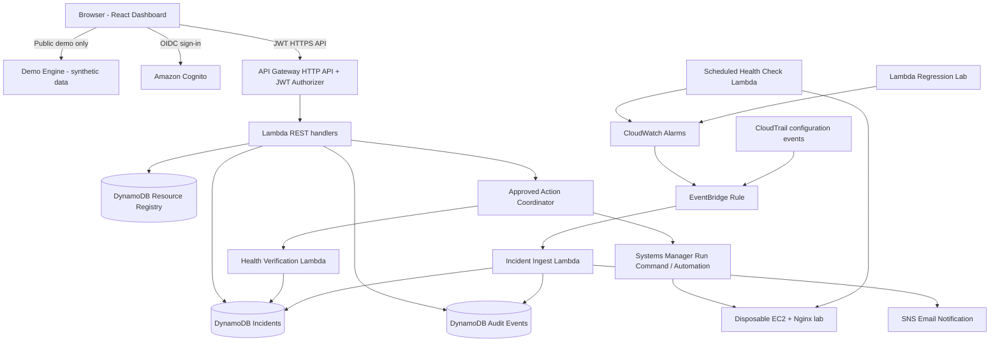
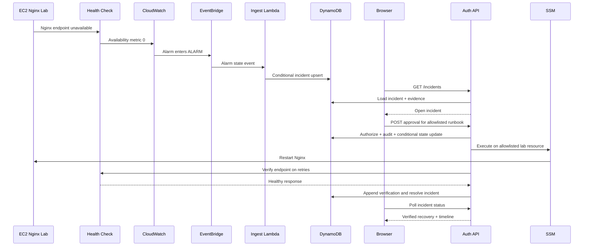
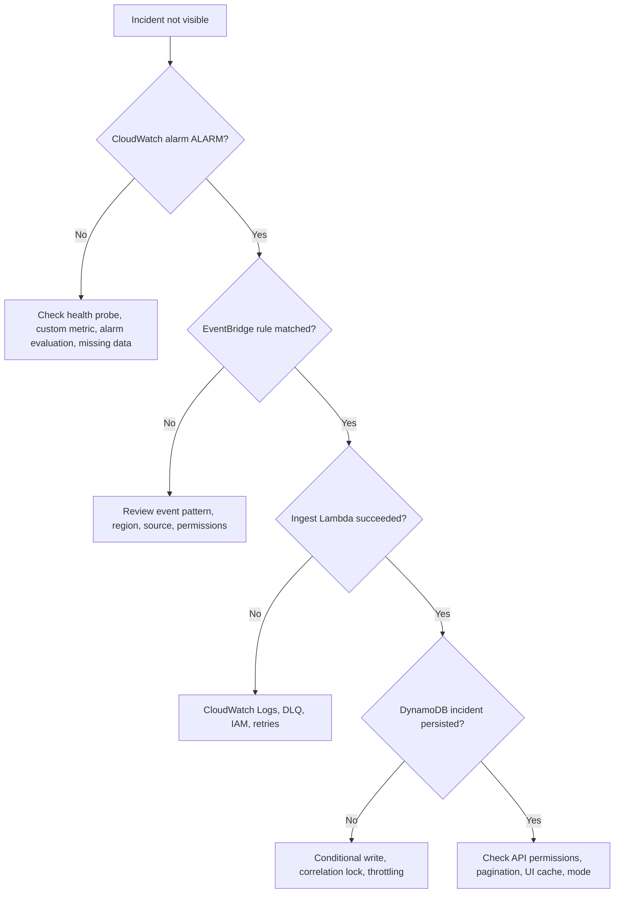

# Opsentra — Master Project Blueprint

> **Version:** 1.11.0 (Phases 1–8 complete; Phase 9 gate tested, owner review pending)  
> **Date:** 2026-11-13  
> **Repository:** https://github.com/jervilangelo/opsentra  
> **Project state:** Phases 1–5 complete (gates passed 2026-11-12). Phases 6 (approved remediation), 7 (Live Simulation Lab) and 8 (analytics and observability) passed their gates and were approved by the owner on 2026-11-13. Phase 9 is next. The control plane is deployed in `ap-southeast-1`; the disposable lab is created only for tests.  
> **Tagline:** *Monitor. Detect. Respond. Recover.*  
> **Primary goal:** An interview-ready, **UI-first**, demonstrably real AWS Cloud Operations and Incident Response platform built using Terraform, serverless AWS services, and controlled failure simulations.  
> **Primary audience:** Junior Cloud Engineer / Cloud Infrastructure Engineer recruiters, and IT/cloud operations teams.  
> **Owner:** Repository maintainer.

---

## 0. How to use this master plan

This is the **source of truth** for Opsentra's scope, design decisions, phased implementation, security constraints, acceptance criteria, cost strategy, and demonstration scenarios. Do not treat planned components as already implemented. Every phase must meet its Definition of Done before moving on. This document is intentionally more complete than the MVP; later sections mark stretch and deferred work.

**Change control:** Proposed changes are documented in an Architecture Decision Record (ADR) and reflected here; the version number and change log are updated. Do not allow implementation assistants to silently alter security scope, deploy infrastructure, or commit major architectural changes without review. Branding was **approved on 2026-11-10** (ADR-010: Continuity Shift); changes to the logo, palette or typography go through the same ADR process.

**Operating principles:**

1. **UI-first, but engineering-real:** the browser controls demonstrations; actual backend integrations must have measurable evidence. Development may use CLI, but the interview demo must not require it.
2. **Separate Demo and Live AWS modes.** Demo uses clearly labeled synthetic, deterministic data; Live uses authenticated AWS-backed APIs. Never present mock data as real telemetry.
3. **Safe by construction:** never execute arbitrary commands or Terraform from an exposed browser endpoint; use only known, scoped test resources and reviewed runbooks.
4. **Terraform-first:** define AWS resources as code; distinguish bootstrap resources, control plane, and disposable labs in separate state.
5. **Minimize ongoing cost:** deploy intermittent labs only for tests; don't rely on alerts as a hard cap; regularly review spend.
6. **Evidence-driven:** provide screenshots, CloudWatch logs, traces, test results, diagrams, and measured incident timings in the case study.
7. **Single account, single AWS region initially:** prefer `ap-southeast-1`, with account/region parameters and no need for multi-region in MVP.
8. **One end-to-end incident before breadth:** Nginx failure → detection → approval → recovery → verification is the core demo.

### 0.1 Project status and decision register

| ID | Decision | Status | Rationale / note |
|---|---|---|---|
| ADR-001 | Name Opsentra; tagline above | Agreed | Distinct software product positioning; trademark/domain clearance not yet established. |
| ADR-002 | UI-first web app; no CLI in interview | Agreed | Interview presentation priority. |
| ADR-003 | 10 milestone-based phases, not calendar deadlines | Agreed | Work proceeds on acceptance tests, not time estimates. |
| ADR-004 | Demo Mode and Live AWS Mode clearly separated | Agreed | Demo always available even when labs off. |
| ADR-005 | React + Vite + TypeScript + Tailwind + shadcn/ui; React Router, TanStack Query + Zustand | Agreed (2026-11-12) | Settled in the Phase 1 build; see `docs/adr/ADR-005-frontend-stack.md`. |
| ADR-006 | Python AWS Lambda + API Gateway HTTP API + DynamoDB | Agreed (2026-11-12) | Python 3.12, arm64, stdlib-only API; see ADR-014. |
| ADR-007 | Terraform S3 state backend with native locking | Agreed (2026-11-12) | `bootstrap-state` root; `use_lockfile = true`; partial backend config; see ADR-014. |
| ADR-008 | Cognito JWT auth with backend-enforced roles | Agreed (2026-11-12) | Lite tier, admin-only sign-up, PKCE browser client, roles from `cognito:groups`; see ADR-014. |
| ADR-009 | No NAT gateway, RDS, always-on container infrastructure | Default constraint | Protect $150 AWS promotional credit. |
| ADR-010 | Branding: "Continuity Shift" logo system | Agreed (2026-11-10) | Chosen from three concepts after a size/sync-icon review; kit and rules in `brand/` and `brand/BRAND_GUIDELINES.md`. |
| ADR-011 | Phase 1 contract, label and colour-mapping fixes | Agreed (2026-11-12) | One Demo label; `verifiedHealthyAt`, `RemediationRequest`, `OverviewSummary` DTOs; SEV display map; DEGRADED/UNKNOWN colours; light primary = Signal Ink. See `docs/adr/ADR-011-phase1-contract-and-label-fixes.md`. |
| ADR-012 | Demo Mode engine and Phase 2 contract additions | Agreed (2026-11-12) | `investigate`/`close` routes, remediation list, Runbook/AuditEvent/LabScenario/AnalyticsSummary DTOs, `SECURITY_GROUP` resource type, typed mutation guards. See `docs/adr/ADR-012-demo-engine-and-contract-additions.md`. |
| ADR-013 | Easy and Advanced views | Agreed (2026-11-12) | Per-browser `view` preference, Easy by default; presentation only, same data source, guards and audit. See `docs/adr/ADR-013-easy-and-advanced-views.md`. |
| ADR-014 | Phase 3 AWS foundation choices | Agreed (2026-11-12) | Python 3.12, SSE-S3/AWS-owned keys, plan-only OIDC role, logs-only Lambda role, budget excluding credits, mocked `terraform test`. See `docs/adr/ADR-014-phase3-aws-foundation.md`. |
| ADR-015 | Phase 4 lab design and Live adapter | Agreed (2026-11-12) | Own VPC, HTTP-only probe target, self-terminating lab with required expiry, self-disabling probe, registry via Terraform, PKCE sign-in, `VITE_COGNITO_DOMAIN`. See `docs/adr/ADR-015-phase4-lab-and-live-adapter.md`. |
| ADR-016 | Incident pipeline | Agreed (2026-11-12) | Validated ingest, `EVENT#` dedup, correlation transaction, verified self-heal, reconciler, idempotent versioned actions, append-only audit, SNS once per incident, DLQ. See `docs/adr/ADR-016-incident-pipeline.md`. |
| ADR-020 | Phase 9 security hardening | Agreed (2026-11-13) | Coordinator/reconciler IAM narrowed to RestartNginx; production CSP; no catch-all route (a JWT `$default` broke CORS preflight and was reverted); admin MFA open (F2); repeatable security scripts. See `docs/adr/ADR-020-security-hardening.md`. |
| ADR-019 | Live analytics, reports and observability | Agreed (2026-11-13) | Shared §4.5 definitions (Live = Demo, halves rounded up, median n ≥ 3, p90 n ≥ 10); `GET /v1/analytics`; availability from probe SampleCount with coverage, unknown when absent; recovery outcomes from HEALTH_VERIFIED evidence; sanitized JSON/CSV exports; structured log IDs; CloudWatch dashboard; API may read metric statistics (only wildcard). See `docs/adr/ADR-019-analytics-and-observability.md`. |
| ADR-018 | Live Simulation Lab and guardrails | Agreed (2026-11-13) | Scenario A live, B/C planned; lab-controller Lambda (API keeps no SSM/EC2 rights); hash-pinned injection; preflight, confirmation, one-run lock, 5-min cooldown, 45-min run limit; watchdog in the reconciler; reset never resolves; read-only teardown verifier. See `docs/adr/ADR-018-live-simulation-lab.md`. |
| ADR-017 | Approved remediation | Agreed (2026-11-12) | Hash-pinned runbooks, request/decision, self-approval flagged, coordinator lock (one command per approval), SSM status events, 3-healthy-probe verification, denied attempts audited. See `docs/adr/ADR-017-approved-remediation.md`. |

### 0.2 Explicit non-goals (MVP)

Not a replacement for AWS Console, PagerDuty, Datadog, or Systems Manager; not a commercial multi-tenant SaaS; no multi-account role federation; no cross-region failover; no Kubernetes/EKS; no Bedrock/LLM root-cause diagnosis; no unrestricted SSH/session-shell browser; no generic Terraform apply button; no real customer or confidential business data; no public access to destructive workflows; no promises of perfect uptime or immediate event delivery.

---

## 1. Business context and measurable outcomes

### 1.1 Fictional customer

**HarborPoint Solutions** is a **fictional** Philippine organization with ~200 employees and a lean IT operations team. Its sandbox environment represents three illustrative workloads:

| Workload | Purpose | AWS services | Operational risk |
|---|---|---|---|
| Corporate web server | Public-facing information | EC2, Amazon Linux, Nginx | Nginx stops responding while EC2 remains running. |
| Ticketing API | Employee support requests | API Gateway, Lambda, DynamoDB | New Lambda version raises 5xx / invocation errors. |
| Document repository | File storage example | S3 | Incorrect resource configuration or failed access checks. |

**Pain points:** fragmented consoles, slow failure detection, unaudited recovery, limited cross-resource visibility, and little proof of operational maturity. Opsentra centralizes *selected* signals and tightly scoped recovery actions.

### 1.2 Core user stories

| ID | Persona | User story | Validation |
|---|---|---|---|
| US-001 | Public visitor | I can try a complete simulated incident without an account. | Demo works offline with synthetic data after app load. |
| US-002 | Viewer | I can inspect live resource health and incident history. | Viewer has read-only permissions. |
| US-003 | Operator | I can acknowledge, assign, investigate, and propose remediation. | Transitions and ownership audited. |
| US-004 | Administrator | I can approve a safe preconfigured action for a lab resource. | Resource/action allowlist, approval, result and identity audited. |
| US-005 | Engineer | I can see logs, metric graphs, related alarm and runbook status. | Incident details include evidence and timestamps. |
| US-006 | Interviewer | I can observe a real AWS failure and recovery entirely through the UI. | Live demo flow requires no terminal. |
| US-007 | Maintainer | I can deploy/destroy environments with Terraform and estimate spend. | Reproducibility and cleanup verification. |
| US-008 | Engineer | Duplicate or delayed events do not create duplicate/reopened incidents. | Idempotency, correlation, stale-event integration tests. |

### 1.3 Success metrics (targets, not claims)

- Demo Mode completes a scripted failure-to-recovery walkthrough with no AWS dependency.
- Live Mode reproduces **one** genuine EC2/Nginx outage and restores health through the web UI.
- All privileged APIs deny unauthenticated users and users lacking the required role.
- One incoming fault yields one active correlated incident despite duplicate delivery.
- Remediation does not mark an incident resolved until post-action health checks pass.
- Every incident timeline includes detection, acknowledgement, approval, execution, verification, and outcome as applicable.
- Initial control plane aim: **under ~$5 per month at low/no traffic** (planning target only; actual charges require billing verification).
- No test infrastructure accidentally left running after demonstrations.
- At least three documented scenarios by Phase 10, with the Nginx scenario mandatory and others depending on budget/time.

---

## 2. Product experience, UX, and branding

### 2.1 Product identity

**Name:** Opsentra. **Description:** Cloud Operations & Incident Response Platform. **Promise:** Make cloud infrastructure easier to observe, understand, and recover. **Tagline:** Monitor. Detect. Respond. Recover.

Brand personality: calm under pressure, practical, precise, secure, technically credible. Avoid misleading glowing metrics, heavy visual effects, generic stock graphics, unrestrained neon, and overcomplicated animations.

**Approved identity (ADR-010):** the **Continuity Shift** symbol (one ring split on its vertical axis, halves offset ±12 on a 256 grid with overlapping end faces: an incident is a shift in a system that stays whole) with a lowercase `opsentra` wordmark in Inter SemiBold, outlined. The kit in `brand/` contains primary/light/dark/monochrome SVG lockups, symbol and small-size cut, adaptive `favicon.svg` + `favicon.ico`, web/PWA icons, brand board and GitHub social preview. `brand/BRAND_GUIDELINES.md` is the source of truth for logo usage, clear space, minimum sizes and dashboard branding.

**Approved tokens:** Ops Navy `#0B1220`, Surface `#172338`, Line `#24324A`, Signal `#38BDF8` (accent on dark), Signal Deep `#0284C7` (accent/symbol on light), Signal Ink `#0369A1` (accent text on light), Cloud `#F8FAFC`, Slate `#94A3B8`. Status colours have dark-UI / light-UI pairs: healthy `#34D399` / `#047857`, warning `#FBBF24` / `#B45309`, critical `#FB7185` / `#BE123C`. Inter for UI; IBM Plex Mono for technical codes, IDs and metrics. Contrast values are documented in the brand guidelines (WCAG 2.2 AA); never communicate status through color alone, and never recolour the logo with status colours.

**Health and severity display (ADR-011):** `HEALTHY` → healthy, `DEGRADED` → warning, `UNHEALTHY` → critical, `UNKNOWN` → Slate `#94A3B8` (dark) / Slate Ink `#475569` (light), always with a text label and icon. Severity badges read `SEV-1 · Critical`, `SEV-2 · High`, `SEV-3 · Medium`, `SEV-4 · Low`; the DTO keeps `CRITICAL/HIGH/MEDIUM/LOW`. On light backgrounds the primary button fill is Signal Ink (white text 5.9:1); Signal Deep remains the symbol and focus-ring colour.

### 2.2 Primary navigation / IA

1. **Overview:** current health, incident counters, latest events, monitored count, last sync.
2. **Infrastructure:** grouped registered resources (EC2, Lambda, API Gateway, DynamoDB, S3), filters, health and safe details.
3. **Incidents:** search/filter, severity, owner, status, chronological history, bulk actions only where safe.
4. **Incident Detail:** root-cause hypotheses (not unsupported claims), alarm evidence, metric charts, event timeline, runbooks, approvals, recovery verification.
5. **Recovery Center:** scoped runbook catalog, eligibility, execution state and past actions.
6. **Simulation Lab:** guided Demo Mode and admin-only Live test scenarios with confirmation and cleanup.
7. **Analytics:** frequency, severity, MTTA/MTTR, runbook success, incomplete-data notices.
8. **Architecture:** visual topology and event flow of Opsentra; static diagrams initially, registered resource links later.
9. **Audit & Settings:** read-only audit events, role display, status, thresholds, toggles controlled by backend.

**UI-wide (v1.4.0, ADR-013):** an **Easy / Advanced view** toggle, Easy by default. Easy shows four plain-language destinations (Home, Incidents, Practice lab, Activity & settings), one sentence and one next-step button per screen, and a recovery path on each incident. Advanced is the full interface. The view never changes data, roles or rules. **Also UI-wide:** persistent mode banner (`DEMO — SYNTHETIC DATA` vs `LIVE AWS — ap-southeast-1`), environment badge, refresh age, accessible toasts, loading/error/empty states, keyboard support, responsive desktop-first design, no fake "real-time" labels. Live Mode must fail closed if auth/network unavailable; do not auto-fallback to mocked status while retaining a Live label.

### 2.3 Data-driven interactions

- Demo Mode uses deterministic scenario state and an explicit reset button; state may be saved in browser session storage, but never masquerades as persistent AWS incidents.
- Live Mode uses backend-issued incident timestamps; UI must display UTC data localized for the user with the source time available.
- UI displays each asynchronous action's state: requested → authorized → executing → verifying → succeeded/failed.
- No "success" toast until backend verifies the operation result.
- Critical controls require an explicit confirmation naming the resource, environment, and action. No insecure single-click destructive commands.
- Approval decision includes a short reason, correlation ID, and resolved subject identity.

### 2.4 UI frontend contracts (TypeScript sketch)

```ts
type Mode = 'demo' | 'live';
type Health = 'HEALTHY' | 'DEGRADED' | 'UNHEALTHY' | 'UNKNOWN';
type Severity = 'CRITICAL' | 'HIGH' | 'MEDIUM' | 'LOW';
type IncidentState =
  | 'OPEN' | 'ACKNOWLEDGED' | 'INVESTIGATING'
  | 'AWAITING_APPROVAL' | 'REMEDIATING' | 'VERIFYING'
  | 'RESOLVED' | 'ESCALATED' | 'CLOSED';
type RunbookState = 'PENDING' | 'APPROVED' | 'REJECTED' | 'RUNNING' | 'SUCCEEDED' | 'FAILED';
interface ResourceSummary {
  id: string; arn?: string; type: 'EC2'|'LAMBDA'|'APIGW'|'DYNAMODB'|'S3';
  environment: 'lab'|'dev'; region: string; health: Health;
  lastCheckedAt?: string; evidenceAvailable: boolean;
}
interface Incident {
  id: string; correlationKey: string; resourceId: string;
  title: string; severity: Severity; state: IncidentState;
  openedAt: string; detectedAt?: string; acknowledgedAt?: string;
  verifiedHealthyAt?: string; // v1.2.0: set only after independent health checks pass (§4.5 MTTR)
  resolvedAt?: string; version: number; runbookId?: string;
}
interface TimelineEvent {
  id: string; incidentId: string; occurredAt: string;
  eventType: string; actorType: 'SYSTEM'|'USER'; actorId?: string;
  detail: Record<string, unknown>;
}
// v1.2.0 (ADR-011): mirrors the §4.3 opsentra-remediations table
interface RemediationRequest {
  requestId: string; actionKey: string; incidentId: string; resourceId: string;
  requestedBy: string; approvedBy?: string; status: RunbookState;
  executionId?: string; expectedVersion: number; errorSummary?: string;
  requestedAt: string; decidedAt?: string; completedAt?: string; expiresAt: string;
}
// v1.2.0 (ADR-011): payload of GET /v1/overview
interface OverviewSummary {
  monitoredResources: number; healthCounts: Record<Health, number>;
  activeIncidents: number; activeBySeverity: Record<Severity, number>;
  lastSyncAt?: string;
}
```

Success payloads are wrapped as `{data, meta}`; `meta.dataset` is `'synthetic'` or `'live'` so a view can prove which dataset it shows.

**v1.3.0 (ADR-012):** `ResourceSummary.type` adds `'SECURITY_GROUP'`; new DTOs `Runbook`, `AuditEvent`, `LabScenario`, `AnalyticsSummary`, `Role`, and typed mutation inputs (`MutationGuard {expectedVersion, idempotencyKey}` plus `reason`/`runbookId`/`decision` where applicable). Identity and role are never request fields. Full shapes in ADR-012 and `apps/dashboard/src/types/domain.ts`.

**v1.10.0 (ADR-019):** `Incident` adds optional `alarmName`. `MeanDuration` adds optional `medianSeconds` (n ≥ 3) and `p90Seconds` (n ≥ 10). `AnalyticsSummary` adds optional `recoveries {afterRunbook, selfHealed, unknown}` (Live only), `availability.expectedProbes` (minutes in range, for coverage) and `dataQuality: string[]`.

**v1.9.0 (ADR-018):** `LabScenario` adds optional `preflight` (`LabPreflightCheck {id, label, ok, detail?}[]`), `activeRun` / `lastRun` (`LabRun {runId, scenarioId, resourceId, status: LabRunStatus, injection, startedAt, startedBy, expiresAt, incidentId?, endedAt?, endedBy?, endReason?}`), `cooldownUntil` and `labExpiresAt`. `LabRunStatus` is `ACTIVE | COMPLETED | RESET | EXPIRED | FAILED`. New input `ResetLabInput {idempotencyKey}`. `AuditEvent.targetType` `'LAB'` is now used.

---

## 3. Architecture and boundaries

### 3.1 Logical architecture



EventBridge events are at-least-once/best-effort depending on source; design for retries, idempotence, missed event reconciliation, and delayed delivery. Health metrics should have explicit sample interval and alarm evaluation settings; do not promise instant detection. The event source of a Lambda error alarm is CloudWatch metric/alarm state, not simply any failed invocation.

### 3.2 Separate planes and blast radius

| Plane | Scope | Lifetime | Security posture |
|---|---|---|---|
| Frontend Demo | Static GitHub Pages build; synthetic data | Persistent | No AWS credentials or privileged calls. |
| Control plane | Cognito, API Gateway, Lambda, DynamoDB, EventBridge, SNS | Long-lived when affordable | Authenticated, least privilege; minimal VPC networking. |
| Lab plane | Single disposable EC2/Nginx, separate Lambda regression, disposable security group | Created only when testing | Tagged and allowlisted; teardown mandatory. |
| Terraform state | Dedicated versioned S3 bucket | Persistent | Encryption, tight IAM, access logging as appropriate; never public. |

**Networking:** Lambda functions that use only AWS public service endpoints should remain outside a VPC initially. EC2 lab in a public subnet with SSM-capable role, restrictive security group, HTTP test endpoint; avoid inbound SSH entirely (SSM Session Manager optional for development). No NAT gateway or load balancer for the MVP. Health-check Lambda must reach the lab endpoint and be rate-limited. HTTP is acceptable for a disposable diagnostic test endpoint with no user data; public product APIs must use HTTPS. Prefer instance metadata service v2 and encrypted EBS.

### 3.3 AWS components, justification, and constraints

| Component | MVP responsibility | Notes |
|---|---|---|
| CloudWatch | Logs, alarms, metric data | Retention 7–14 days during lab; custom metric cardinality low. |
| EventBridge | Alarm and selected CloudTrail events | Rule exact match; DLQ/retry policy as appropriate; reconcile omissions. |
| Lambda | API handlers, ingestion, health check, verify | Structured JSON logs, idempotent handlers, tuned memory/timeouts. |
| API Gateway HTTP API | JWT-secured HTTPS endpoints | CORS exact origin, stage throttling via appropriate controls/usage patterns. |
| DynamoDB | Incidents, resources, audit | On-demand small tables; conditional writes for concurrency. |
| Cognito User Pool | Admin/operator/viewer authentication | Authorization in backend; don't trust UI roles alone. |
| SNS | Email notifications | Rate limiting and incident deduplication. |
| Systems Manager | Fixed lab remediation documents / Run Command | SSM Agent and IAM role needed; not every action is free. |
| CloudTrail | Management event provenance | Scope and cost of event options reviewed before use. |
| Terraform | Declarative infrastructure | S3 native lockfile and state versioning. |
| GitHub Actions | Tests, builds, reviewed deploys | AWS OIDC trust restricted to repo/ref/environment. |
| S3 | Terraform state and small artifacts | Versioning, private access; storage costs monitored. |
| GitHub Pages | Frontend hosting | Demo public; Live functions only through authorized AWS API. |

Optional after MVP: AWS X-Ray or OpenTelemetry tracing, Athena queries, AWS Config/CloudTrail Lake/Security Hub (cost reviewed), real-time infrastructure drift checks, cost explorer (cost API fees/latency), additional regions.

### 3.4 Key end-to-end event flow



**Caveat:** Approved remediation must be decoupled from a single API request; an asynchronous execution coordinator plus status polling is preferred. Implement the simple Lambda/DynamoDB workflow first; Step Functions can be introduced if orchestration complexity justifies incremental cost. Approval and execution may be separate API calls and principals.

---

## 4. Backend services, API, and persistence

### 4.1 Suggested service layout

- `api`: read resources/incidents/analytics, acknowledge, approvals, simulation lab controls; role checks at the endpoint level.
- `incident-ingest`: validate allowlisted EventBridge source/detail-type, correlate resource and alarm, update incident state, emit audit/notification only on state change.
- `health-check`: scheduled, rate-limited HTTP diagnostic checks; emits availability metric with minimum labels.
- `action-coordinator`: locks a remediation request, validates token-derived identity and protected resource eligibility, dispatches approved action.
- `action-reconciler`: polls or consumes execution status, verifies service health, marks succeeded/failed, prevents duplicate executions.
- `inventory-sync`: only registered/allowlisted resources, with last-seen timestamps and role-aware projection.
- `lab-controller`: admin-only, explicitly labeled destructive *test-only* endpoints and cleanup operations. **v1.9.0 (ADR-018):** implemented as the `opsentra-dev-lab-controller` Lambda (code in `services/incidents`, module `lab_controller`), invoked synchronously by the API only; the watchdog runs in the reconciler.

### 4.2 API contract (initial draft; use `/v1`)

| Method | Route | Role | Behavior |
|---|---|---|---|
| GET | `/v1/me` | Authenticated | Identity, permitted actions, environment. |
| GET | `/v1/overview` | Viewer+ | Summary counts and last updated timestamps. |
| GET | `/v1/resources` | Viewer+ | Paginated filtered inventory. |
| GET | `/v1/resources/{resourceId}` | Viewer+ | Health and evidence references. |
| GET | `/v1/incidents` | Viewer+ | Paginated, filterable incidents. |
| GET | `/v1/incidents/{incidentId}` | Viewer+ | Incident detail and version. |
| GET | `/v1/incidents/{incidentId}/timeline` | Viewer+ | Ordered audit/evidence events. |
| POST | `/v1/incidents/{incidentId}/acknowledge` | Operator+ | Conditional state transition; reason required. |
| POST | `/v1/incidents/{incidentId}/investigate` | Operator+ | v1.3.0. `ACKNOWLEDGED → INVESTIGATING`; expected version + idempotency key. |
| POST | `/v1/incidents/{incidentId}/request-remediation` | Operator+ | Allowed action request; idempotency key required. |
| POST | `/v1/incidents/{incidentId}/close` | Operator+ | v1.3.0. `RESOLVED → CLOSED`; expected version + idempotency key. |
| GET | `/v1/remediations` | Viewer+ | v1.3.0. Recovery requests, newest first; optional `incidentId` filter. |
| POST | `/v1/remediations/{requestId}/decision` | Admin | Approve/reject; server-side role check, audit, optimistic lock. |
| GET | `/v1/remediations/{requestId}` | Viewer+ | Execution status and sanitized logs. |
| GET | `/v1/runbooks` | Viewer+ | Readable allowlisted runbooks and applicability. |
| GET | `/v1/analytics` | Viewer+ | Calculated metrics for selected date range. |
| GET | `/v1/audit` | Admin | Paginated audit record retrieval. |
| GET | `/v1/labs` | Admin | Allowed lab scenarios and readiness. |
| POST | `/v1/labs/{scenarioId}/start` | Admin | Validate lab tag/ARN; preflight, quota, cooldown, confirmation. |
| POST | `/v1/labs/{scenarioId}/reset` | Admin | Safe cleanup/reset; no arbitrary targets. |

**v1.10.0 (ADR-019):** `GET /v1/analytics?from&to` is implemented (Viewer+; default 30 days, max 92, ISO-8601 with offset; 400 `VALIDATION` otherwise).

**v1.9.0 (ADR-018):** the three lab routes are implemented. `start` needs `acknowledgeImpact: true` and an `Idempotency-Key`; the body carries nothing else. Refusals: 400 `CONFIRMATION_REQUIRED`, 403 `FORBIDDEN`, 404 unknown scenario, 409 `LAB_BUSY` / `PREFLIGHT_FAILED` / `LAB_NOT_DEPLOYED`, 502 `LAB_INJECTION_FAILED` / `LAB_RESET_FAILED`, 503 `LAB_UNAVAILABLE`. Reset ends the run but never resolves an incident.
| GET | `/v1/health` | Public minimal | Non-sensitive API heartbeat; no resource discovery. |

**API standards:** JSON UTF-8; consistent `{data,meta}` successes, `{error:{code,message,requestId}}` errors; 400 validation, 401 auth missing/invalid, 403 forbidden, 404 missing/inaccessible, 409 optimistic-lock conflict, 429 throttled, 5xx unexpected; ISO-8601 UTC; page tokens; request IDs; `Idempotency-Key` on mutations; never expose internal stack traces, AWS account identifiers, IAM policies, or sensitive resource configuration to unauthenticated clients. Client should handle transient faults, refresh, and stale state without inventing success.

### 4.3 DynamoDB schema design

Separate small on-demand tables for readability and independent permissions:

**`opsentra-incidents`**: `PK=incidentId` (string), attributes `correlationKey`, `resourceId`, `severity`, `state`, `version`, `openedAt`, `lastSignalAt`, `acknowledgedAt`, `resolvedAt`, `assignedTo`, `alarmArn`, `currentRemediationRequestId`, `ttl` for optional noncritical test history after retention decision. GSI `gsi1PK=CORRELATION#<key>`, `gsi1SK=<openedAt>` to look up the active episode; another GSI for status/date if necessary. Never rely on a GSI read alone for uniqueness: use a **separate correlation lock/active incident mapping** with conditional `PutItem` or DynamoDB transaction.

**`opsentra-resources`**: `PK=resourceId`, registration/allowlist fields `accountId`, `region`, `type`, `arn`, `environment`, `allowedRunbookIds`, `labExpiresAt`, `health`, `lastCheckedAt`, `tagVerificationAt`. Store known resource ARNs server-side, not user-supplied execution targets.

**`opsentra-audit`**: `PK=INCIDENT#<id>` or `ACTION#<id>`, `SK=<ISO timestamp>#<ULID>`, event type, actor, correlation ID, previous/new state, sanitized evidence references, outcome. Use IAM deny mutation patterns where feasible: producer can append but not update/delete; verify audit sequence integrity at integration level. This is **application-level tamper resistance, not legal-grade immutable WORM evidence**; stronger immutability deferred.

**`opsentra-remediations`** (recommended fourth table): `PK=requestId`, actionKey, incidentId, resourceId, requestor, approver, status, executionId, idempotencyKey, expectedVersion, errorSummary, timestamps, expiry. Conditional transitions to guard execution races.

**v1.8.0 (ADR-017):** remediation items add `runbookId`, `runbookVersion`, `documentHash` (pinned at request time), `requestedByRole`, `selfApproved`, `decisionReason`, `startedAt`; `executionId` is the SSM command ID. Incidents add `activeRequestId`. Registry items add `runbooks` (`runbookId → {document, documentHash}`) and the probe's `healthyStreak` / `healthyStreakSince`. `RemediationRequest` DTO adds optional `selfApproved`. **v1.8.1:** verification uses `start = max(healthyStreakSince, completedAt)` and needs HEALTHY, an unbroken `healthyStreak ≥ 3` and `lastCheckedAt ≥ start + 2 min` (at least 3 probes after the fix at the 1-minute cadence). Escalation writes use separate `SET … REMOVE activeRequestId` clauses.

**`opsentra-lab-runs`** (v1.9.0, ADR-018, sixth table): `PK=runId` (`LAB-YYYYMMDD-XXXXXX`) with `scenarioId`, `resourceId`, `status`, `injection`, `commandId`, `documentHash`, `startedAt`, `startedBy`, `expiresAt`, `incidentId`, `endedAt`, `endedBy`, `endReason`; plus one `runId=LOCK` item holding `activeRunId` and `cooldownUntil` (conditional writes serialize starts). Lab audit items use `PK=LAB#<scenarioId>`. Registry items add `scenarios` (`scenarioId → {document, documentHash}`) for the hash-pinned injection document.

**`opsentra-active-correlations`** (optional fifth table): correlation key → incident ID with conditional creation and explicit clear on verified terminal close; avoid accidental duplicates across asynchronous event replay.

**v1.7.0 (ADR-016):** the correlation item keeps `lastResolvedAt` after a verified resolution so older ALARMs never reopen it; correlation keys are `region:resourceId:alarmName` (no account ID). The audit table also holds `EVENT#<eventId>` delivery markers (TTL 7 days) and `IDEMPOTENCY#<key>` records (TTL 24 h). Incidents gain `lastSignalAt`, `signalClearedAt`, `assignedTo` and `alarmName`. Registry items gain `alarmNames`, `alarmTitles` and `severity`.

**Schema tradeoff:** a single-table design is possible, but separate tables prioritize understandability and role-scoped access for an interview project. Document read/write costs and adjust after load tests.

### 4.4 Incident state model and invariants

```text
OPEN -> ACKNOWLEDGED -> INVESTIGATING -> AWAITING_APPROVAL
  -> REMEDIATING -> VERIFYING -> RESOLVED -> CLOSED
               \-> ESCALATED (on failure, timeout, denied approval)
```

Transitions must be validated server-side; some flows can jump directly from OPEN to RESOLVED **only if verified independently** (self-healing), or skip approval for a deliberately configured low-risk runbook only after documented risk approval. MVP recovery always requires administrator approval.

Invariants:

- Exactly one active incident per `(account, region, resource, alarm/scenario key, active episode)`.
- Repeated CloudWatch events update last-seen and evidence, not new incidents.
- Terminal resolution requires real post-remediation health verification and verified resource identity.
- Old/out-of-order `ALARM` events do not reopen a newer resolved episode unless the health condition is currently failing.
- Failed/denied/expired approvals cannot execute.
- Replayed approval requests cannot launch a second SSM action.
- Every state transition is conditional on expected version and appended to audit.
- If ingestion fails, retry or DLQ, then reconcile alarms with persisted incidents.

### 4.5 MTTA / MTTR definitions

- **Detection timestamp:** time recorded by monitoring (plus `receivedAt` separately); timestamps measured in UTC.
- **MTTA:** mean(`acknowledgedAt - detectedAt`) for acknowledged incidents; explicitly exclude unacknowledged cases and show count.
- **MTTR (recovery):** mean(`verifiedHealthyAt - detectedAt`) for recovered incidents, not simply runbook finished time. Display denominator, percentiles where data supports them, and whether dataset is synthetic or live.
- **Availability:** healthy probes / total valid probes within a defined range; distinguish EC2 running from Nginx service availability.
- **v1.10.0 (ADR-019):** median when n ≥ 3, p90 (nearest rank) when n ≥ 10; durations rounded halves up in Live and Demo alike. Availability counts probes *received*; with no probes it is unknown (omitted), and coverage below 90 % is annotated. Recovery outcomes (runbook vs self-heal) come from the `HEALTH_VERIFIED` evidence.

---

## 5. Authentication, authorization, and threat model

### 5.1 Trust boundaries

1. **Untrusted public web:** GitHub Pages static JavaScript, local Demo Mode.
2. **Authenticated user boundary:** Cognito login; API Gateway JWT authorizer verifies issuer/audience/expiry; handlers authorize group/action based on trusted claims, not submitted strings.
3. **Privileged control boundary:** only backend roles execute AWS API actions; all parameters validated against server-owned allowlist and resource tags.
4. **Lab boundary:** disposable specifically tagged resources; denial of any cross-account/production target.
5. **CI/CD boundary:** short-lived GitHub OIDC credentials for narrow branch/environment, separate deploy permissions; no static AWS keys in GitHub Secrets where avoidable.

### 5.2 Role matrix

| Operation | Public Demo | Viewer | Operator | Administrator |
|---|---:|---:|---:|---:|
| Navigate synthetic demo | Yes | Yes | Yes | Yes |
| Read live resource/incident data | No | Yes | Yes | Yes |
| Acknowledge / assign incident | No | No | Yes | Yes |
| Request remediation | No | No | Yes | Yes |
| Approve / reject remediation | No | No | No | Yes |
| Trigger destructive lab simulation | No | No | No | Yes |
| Read full audit timeline | No | Limited | Limited | Yes |
| Modify allowlists / thresholds | No | No | No | Restricted admin via reviewed config |

A single user may administrate the personal demo, but workflows still record identity and enforce authorization. For a stronger enterprise story, optionally require separate requester and approver identities when multiple test accounts exist.

### 5.3 Threats and mitigations

| Threat | Mitigation | Test |
|---|---|---|
| Unauthenticated remediation | API authorizer and backend role check | 401/403 integration tests |
| IDOR across resource IDs | Server-owned allowlist and account/region scoping | Substitute arbitrary ARN/ID → denied |
| Command injection | Fixed runbook ID and validated structured parameters | Shell metacharacters rejected |
| Duplicate event/replay | Idempotency key, conditional writes, execution lock | Duplicate N events → one execution |
| Privilege escalation via claims | Cognito trusted group mapping; no role from request body | Forged body role ignored |
| Public secrets in frontend | Public config only; no keys; secret scanner | Repo scan and build artifact inspection |
| SSRF via health check URLs | Only server-registered hosts/paths; no arbitrary URL | Private/local IP and unknown host rejected |
| False health or spoofed event | AWS service-sourced event rules, registered ARN and independent verification | Fake resource event ignored |
| Incident history tampering | Append-only audit producers, restricted IAM writes, exports | Update/delete denied |
| Uncontrolled expenses | TTL cleanup, budgets, quotas, manual destroy, tagged resources | Fresh deployment and teardown tests |
| Insecure public EC2 | No SSH ingress, SSM role, restricted HTTP test endpoint, no real data | Security group tests |
| Stale event state | Event timestamps + present-state reconciliation | Out-of-order replay test |

**No public lab controls, even with client-side hidden buttons.** Backend permissions are mandatory. AWS Budgets and billing alerts are not spending limits, can arrive late, and should never be the sole protection against charges.

---

## 6. Failure scenarios / interview demonstrations

### 6.1 Scenario A — Nginx outage and verified recovery (mandatory)

**Setup:** disposable Amazon Linux EC2 with Nginx (`opsentra:lab=true`, `opsentra:scenario=nginx`, expiry tag), Systems Manager Agent functioning, restrictive IAM instance profile; HTTP health endpoint with no credentials/data. Health Lambda tests it every minute and emits availability custom metric (or CloudWatch Synthetics if priced and justified).

**Trigger:** Admin opens Simulation Lab, reviews exact test instance and cost/safety warning, clicks **Stop Nginx**. Backend validates actor, resource ARN, tags, scenario readiness, and invokes an allowlisted SSM command document `Opsentra-Lab-StopNginx`; does not accept arbitrary commands or hostnames.

**Detection:** HTTP probe returns failure; after configured periods, CloudWatch alarm becomes ALARM; EventBridge signals ingress; ingest writes incident. UI displays true timestamps, alarm ARN reference, last check, correlation and source. Alert email optional.

**Response:** Admin opens incident details, reviews current status and safe recovery runbook; chooses **Request Recovery** then **Approve & Execute** (or separate operator/admin accounts). Coordinator records intent, invokes `Opsentra-Lab-RestartNginx`, polls SSM status and verifies the endpoint across several consecutive successful probes before marking `RESOLVED`.

**Measure:** time to detect, time to acknowledge, time to start remediation, time to verify, MTTR; track timing uncertainty due to probe cadence and alarm evaluation periods. SSM success alone does not imply service recovery.

**Reset:** confirm Nginx running, clean scenario artifacts according to retention, optionally destroy EC2 entirely. Don't leave EC2 running unattended.

**Negative tests:** SSM Agent unavailable; instance stopped; insufficient permissions; Nginx restart fails; health probe returns 200 but wrong body; alarm event duplicate; approval expires; health signal delayed. Expected: visible failure and safe escalation.

### 6.2 Scenario B — Lambda deployment regression and rollback (stretch after A)

**Setup:** Lambda versions with alias `live`; API Gateway routes alias; known-good published version; a purposely failing release for a dedicated test endpoint. Configure metric filters/CloudWatch Lambda `Errors` alarm, low-volume controlled requests, and immutable deployment record.

**Trigger:** Admin clicks **Deploy Faulty Version** (or **Simulate Error**) in lab; backend only alters approved test alias or sends traffic to a version already approved in Terraform. No production function modification.

**Detect:** error alarm; incident correlation; logs (sanitized) and version metadata. **Recover:** rollback alias to known-good published version upon admin approval and run health check. **Verify:** success rate, function version and API response. Handle alias update precondition/version concurrency.

### 6.3 Scenario C — Security group rule exposure (stretch after A)

**Setup:** one isolated tagged security group not attached to sensitive instances; CloudTrail management events available, EventBridge rule for authorized security group change API; periodic reconciliation independently lists the exact test group's ingress rules.

**Trigger:** Admin requests controlled injection of temporary SSH TCP/22 `0.0.0.0/0` on that group, with explicit confirmation and auto-expiry. **Detect:** event or reconciliation finds rule. **Recover:** admin approves removal of only the exact injected rule ID; recheck. **Guardrails:** no production group ARN, no broad revoke, no editing non-lab resources, automatic reset watchdog.

### 6.4 Demo Mode scripted flows

Deterministic local demo cases mirror the three scenarios with realistic but fake instance IDs, logs and durations. UI always displays **DEMO — SYNTHETIC DATA**. Can be replayed/reset. They must not invoke live endpoint URLs or privileged credentials; domain logic mirrors API DTOs where appropriate but data sources are isolated. Offline behavior after first load is optional service-worker enhancement; do not claim offline until implemented and tested.

---

## 7. Delivery plan: ten milestone-based phases

Each phase should produce (a) code/artifacts, (b) tests, (c) short demo, (d) documentation update, and (e) a phase checkpoint. **No weeks or fixed deadlines.** Start a new phase only after reviewing the previous gate. Critical security/cost protections are introduced early even if final audits occur in Phase 9.

### Phase 1 — Branding approval, foundation, UI/UX

**Objective:** Establish final brand, repo structure, frontend foundation, navigation and typed interfaces—without AWS deployment.

**Work:** ~~select approved logo concept; export SVG/favicons/light-dark wordmark; brand guidelines~~ (done: `brand/`); token file; (complete 2026-11-12: see `docs/phases/phase-1-checkpoint.md`); setup React/Vite/TypeScript, Tailwind, shadcn/ui, routing, state/query library, lint/format, tests, responsive accessible layout; build nine page skeletons and reusable components; document API DTOs, fixtures, mode guard; empty states, auth layout, error page; establish architecture overview and design review checklist.

**Deliverables:** running frontend with consistent navigation and no false live data, brand kit, reusable component library, frontend build/test pipeline, project README.

**Gate:** all routes functional; desktop/mobile no clipping; WCAG-friendly focus and contrast reviewed; all placeholders clearly labeled; tests and build pass; branding approved.

### Phase 2 — Fully interactive Demo Mode

**Objective:** Interviewable product before AWS is connected.

**Status:** complete 2026-11-12 (ADR-012, ADR-013): see `docs/phases/phase-2-checkpoint.md`.

**Work:** implement isolated fake-data adapter; deterministic resource inventory; incident state machine; staged synthetic alarm + timeline; approval and recovery UI; error paths; scenario reset; analytics derived from simulated incident history; screen-reader-friendly progress indicators; optional browser-session persistence; create short guided presentation path.

**Deliverables:** public safe demo, dashboard, incident drill-down, simulated Nginx recovery, Demo badge, replay/reset control.

**Gate:** a user can follow Detect → Investigate → Approve → Recover and review audit/events with **no terminal or AWS access**; no confusing simulated vs live telemetry.

### Phase 3 — AWS infrastructure foundation

**Objective:** Reproducible, least-privilege control plane and API.

**Status:** complete 2026-11-12 (ADR-014): see `docs/phases/phase-3-checkpoint.md`. Open: cost check, and the control-plane destroy test deferred by the owner.

**Work:** bootstrap encrypted/versioned S3 state bucket; native `use_lockfile` locking; separate control-plane/lab Terraform roots; parameterized account/region; IAM GitHub OIDC trust with repo/ref scoping; Cognito user pool and roles; API Gateway HTTP API + JWT auth; Python Lambda API; DynamoDB tables; CloudWatch basic logs and retention; budget alarms and tags; secrets scanning; GitHub Actions plan validation. Set a cap on optional managed services via explicit configuration, not unbounded defaults.

**Deliverables:** `terraform plan/apply/destroy` procedures, authenticated `/v1/me` and `/v1/health`, CI with short-lived credentials, IAM policy tests, sanitized `.env.example`.

**Gate:** fresh deploy works in intended AWS account, unauthorized and wrong-role endpoints denied, documented Terraform state path and recovery, no secrets in repo, cost dashboard checked, `terraform destroy` can remove disposable resources.

### Phase 4 — Real AWS monitoring and inventory

**Objective:** Real evidence of workload health appears in Live AWS Mode.

**Status:** complete 2026-11-12 (ADR-015): Nginx stop raised a real alarm in 3 min 33 s; see `docs/phases/phase-4-checkpoint.md`.

**Work:** Terraform EC2/Nginx lab; secure SSM association/profile, no SSH ingress; health-check Lambda and low-cardinality metric; CloudWatch alarm; EventBridge rule; minimal Lambda regression test resource; resource registry and inventory-sync; last-sync and stale data UX; authenticated frontend API adapter with Live badge.

**Deliverables:** AWS inventory and health view, working Nginx probe and CloudWatch alarm, basic event ingestion logs.

**Gate:** stopping Nginx leads to a real health alarm in AWS; UI shows actual resource and health data; metrics and alarm state are not hardcoded. Lab can be destroyed.

### Phase 5 — Incident detection, management, and audit

**Objective:** Persist, deduplicate, and explain cloud incidents.

**Status (2026-11-12):** complete. Gate passed live and approved by the owner: see `docs/phases/phase-5-checkpoint.md`.

**Work:** ingest CloudWatch state change events; schema/source validation; correlation locks and idempotent conditional writes; status machine, acknowledge/assign flows; timeline and audit; SNS event alert with suppression; pagination/filter; alarm reconciler and missing-event repair; no automatic false resolution on event timeout.

**Deliverables:** incident API, incident list/detail UI with real metadata, correlation, audit history and notifications.

**Gate:** duplicated, delayed, malformed and out-of-order test events behave safely; one active incident per active condition; notification not repeated for every duplicate event; timeline tracks all user/system changes.

### Phase 6 — Controlled automated remediation

**Objective:** Implement a real, approved browser-driven recovery action.

**Work:** named, immutable/runbook-versioned actions; server-side resource/action allowlists; request/approve workflow; audit and optimistic concurrency; start SSM Run Command/Automation on designated lab; async coordinator, execution status, timeouts, safe retries; post-remediation health verification; failed execution escalation; backend role boundary and attack tests.

**Deliverables:** Recovery Center, approval modal, execution timeline, verified Nginx restart, audit trail.

**Gate:** genuine Nginx failure recovered without CLI; unauthorized and arbitrary resource operations denied; failed SSM success cannot falsely mark recovered; replay does not repeat action.

**Status (2026-11-13):** code and tests written (ADR-017). Live run 1 found two bugs, fixed in v1.8.1. The live gate re-run passed and the owner approved the gate on 2026-11-13: see `docs/phases/phase-6-checkpoint.md`.

### Phase 7 — Live Simulation Lab and guardrails

**Objective:** Safe, repeatable failure demonstrations from UI.

**Work:** admin-only scenario registry; preflight checks, confirmation messages, cooldown, one-active-scenario lock, session expiry; Nginx stop/restart live flow; optionally Lambda regression rollback and test security group injection; watchdog reset/cleanup on abandoned tests; infrastructure teardown automation; clear budget disclosure.

**Deliverables:** live scenario cards, progress and reset UI, evidence of three scenarios when affordable, fallback demo when live labs off.

**Gate:** every implemented scenario can be started, inspected, recovered/reset without terminal; expired/disconnected scenarios are safely cleaned up; no non-lab resources affected.

**Status (2026-11-13):** built and tested locally (ADR-018); Scenario A is live, B and C stay Demo-only (planned for Live). Deployed; the live gate passed and the owner approved it on 2026-11-13: see `docs/phases/phase-7-checkpoint.md`.

### Phase 8 — Analytics, reporting, and observability

**Objective:** Turn incident evidence into understandable engineering insights.

**Work:** MTTA/MTTR definitions and denominators, time-window filtering, availability probes with missing-data caveats, runbook success rate, recovery outcomes; structured logs with request/correlation IDs; CloudWatch dashboard links; download sanitized JSON/CSV incident report and optionally a printable HTML report; metrics and failures from real data. Optional tracing if justified.

**Deliverables:** analytics page, incident report export, engineering investigation links and data-quality annotations.

**Gate:** numbers reconciled with source events; synthetic and live datasets are never mixed in the same reporting view; missing signals shown as unknown rather than zero failure.

**Status (2026-11-13):** complete; built, deployed, gate-tested live and approved by the owner (ADR-019): see `docs/phases/phase-8-checkpoint.md`. Printable HTML report and tracing not built (optional).

### Phase 9 — Security hardening, testing, optimization

**Objective:** Demonstrate operations discipline rather than a fragile demo.

**Work:** threat-model review; least-privilege IAM audit; negative auth tests, IDOR/SSRF/input validation, replay and race conditions, DLQ/reconciliation, failure injection, TLS/CORS validation; Terraform validate/fmt/plan checks; Python pytest, frontend Vitest, Playwright E2E (demo + protected live smoke); accessible UI audit; load/latency checks with bounded traffic; log retention; budget and cleanup review; dependency updates; repo secret scan and dependency policy.

**Deliverables:** test report with results and limitations, updated threat model, runbooks, cost measurements, resource cleanup evidence.

**Gate:** no outstanding critical/high security findings for public demo/live admin APIs; core tests pass; AWS lab destroy verified; acceptable cost baseline observed.

**Status (2026-11-13):** audit and live gate tests done (ADR-020); no critical or high findings; owner review pending: see `docs/phases/phase-9-test-report.md`.

### Phase 10 — Public release, docs, portfolio case study

**Objective:** Make the project understandable to a recruiter within minutes.

**Work:** publish GitHub Pages demo, protect all Live AWS endpoints; README with problem/architecture/demo; architecture diagrams, IAM model, IaC setup, runbooks, sample incidents and cost log; public screenshots and demo video without account IDs/secrets; interview explanation/story; phase log and ADRs; versioned release; note functionality that is demo-only versus genuinely working; optional issue roadmap.

**Deliverables:** deployable source, working static Demo Mode URL, documented live demo procedure, short architecture walkthrough, repeatable test/demo checklist.

**Gate:** visitor can use Demo Mode without login; authenticated admin can show live workflow when resources are on; documentation and screenshots match actual implementation; no leaked sensitive configuration.

### 7.1 Cross-phase gate checklist template

```markdown
### Phase <N> checkpoint
- [ ] Scope and artifacts complete
- [ ] Screenshots or walkthrough recorded
- [ ] Relevant automated tests passing
- [ ] No unlabeled mock data in Live Mode
- [ ] Auth/IAM and cost impacts reviewed
- [ ] Terraform plan/destroy and cleanup reviewed where applicable
- [ ] New assumptions, tradeoffs and ADRs documented
- [ ] README/master blueprint updated
- [ ] Git branch merged only after review
- [ ] Ready for Phase <N+1>
```

---

## 8. Repository and implementation organization

```text
opsentra/
├── README.md
├── OPSENTRA_MASTER_BLUEPRINT.md
├── brand/                       # approved logo kit and BRAND_GUIDELINES.md
├── LICENSE                      # only after license decision
├── .editorconfig
├── .gitignore
├── .github/
│   ├── workflows/
│   │   ├── frontend-ci.yml
│   │   ├── backend-ci.yml
│   │   ├── terraform-check.yml
│   │   └── deploy.yml         # gated, OIDC, later phase
│   └── pull_request_template.md
├── apps/
│   └── dashboard/
│       ├── public/brand/
│       ├── src/
│       │   ├── app/
│       │   ├── components/
│       │   ├── features/
│       │   ├── modes/demo/
│       │   ├── modes/live/
│       │   ├── api/
│       │   ├── types/
│       │   └── styles/
│       └── package.json
├── services/
│   ├── api/
│   ├── incident-ingest/
│   ├── health-check/
│   ├── action-coordinator/
│   ├── action-reconciler/
│   ├── inventory-sync/
│   └── lab-controller/
├── infrastructure/
│   ├── bootstrap-state/
│   ├── modules/
│   └── environments/
│       ├── control-plane-dev/
│       └── disposable-labs/
├── labs/
│   ├── nginx-ec2/
│   ├── lambda-regression/
│   └── security-group-exposure/
├── tests/
│   ├── integration/
│   ├── e2e/
│   └── fixtures/
├── docs/
│   ├── architecture/
│   ├── adr/
│   ├── api/
│   ├── security/
│   ├── operations/
│   ├── costs/
│   ├── phases/
│   └── interview-demo/
└── scripts/
    ├── verify-cleanup/
    └── bootstrap/
```

Do **not** create placeholder files merely to fill all folders. Build files during their corresponding phase. Public repo must exclude `.terraform/`, state files, credentials, `.env`, IAM credentials, large logs, and personally identifying AWS account details. Review screenshots for identifiers before publication.

---

## 9. Infrastructure as Code and CI/CD specifications

### 9.1 Terraform roots

**`bootstrap-state/`** creates the Terraform state bucket using a one-time local backend/bootstrap procedure, then migrates to remote state; S3 versioning, public access block, encryption, least privilege. Recovery procedure must be documented. **Never destroy shared bootstrap state until all dependent roots are destroyed and snapshots deliberately handled.**

**`control-plane-dev/`** contains Cognito, DynamoDB, API Gateway, Lambda, EventBridge, CloudWatch and IAM services. **`disposable-labs/`** contains EC2, lab Lambda, security group, test alarms. Use separate S3 keys/state and CI policies to reduce blast radius.

Use `terraform fmt -check`, `terraform validate`, provider lockfile, module pinning, and reviewed `plan` output. Use S3 native locking (`use_lockfile = true`) with Terraform 1.10+; **DynamoDB-based state locking is deprecated**. State bucket ACL/policy, `Block Public Access`, TLS-only enforcement, encryption and versioning. Keep backend bucket provision separate from its own dependent state lifecycle.

### 9.2 GitHub Actions workflows

- **Pull request:** frontend lint/typecheck/unit tests/build; Python lint/pytest; Terraform fmt/validate/security scan; artifact and dependency checks; **no AWS write on PR**.
- **Main deployment:** restricted environment with reviewer protection if available, OIDC `id-token: write`, short-lived AWS credentials, Terraform plan and approval; apply only when authorized. OIDC `sub` trust policy restricted to exact repo and protected branch/environment, no wildcard repos.
- **Frontend publish:** GitHub Pages build/deploy; public artifact contains only non-secret configuration and Demo assets.
- **Lab lifecycle:** admin-initiated restricted workflow or backend guardrailed creation; distinct lab permissions and cleanup action, never unrestricted destroy of account resources.
- **Release:** version tag, changelog, screenshots, documented demo status. No unsafe auto-apply from untrusted branches.

### 9.3 Environmental configuration

| Variable | Source | Exposure |
|---|---|---|
| `VITE_APP_MODE_DEFAULT=demo` | Frontend build | Public-safe |
| `VITE_API_BASE_URL` | Frontend build | Public URL only |
| `VITE_COGNITO_USER_POOL_ID` | Frontend build | Public identifier; no client secret |
| `VITE_COGNITO_CLIENT_ID` | Frontend build | Public client ID |
| `VITE_COGNITO_DOMAIN` | Frontend build | Public Hosted UI host (v1.6.0, ADR-015) |
| `AWS_REGION` | Backend runtime | Not a secret |
| `INCIDENT_TABLE`, `RESOURCE_TABLE` | Backend runtime | Not a secret |
| `LAB_ALLOWLIST` | Server-owned registry / backend config | Never user-controlled |
| Sensitive tokens/keys | AWS secret service or short-lived role | Never committed / frontend bundled |

Use a Cognito **public app client** with Authorization Code + PKCE for browser auth, and validate JWT issuer/audience/token-use according to the chosen authorizer. Never put client secrets into Vite bundles.

---

## 10. Testing strategy and quality bar

### 10.1 Test pyramid

| Layer | Tools | What to test |
|---|---|---|
| Frontend unit/component | Vitest, Testing Library | Incident status UI, mode badges, role-based rendering, charts. |
| Backend unit | pytest, moto/stubs as appropriate | Event validation, dedupe logic, state machine, IAM-denial handling. |
| Contract | JSON Schema / OpenAPI validator | DTO compatibility, error response format, pagination. |
| Integration (AWS sandbox) | pytest + scoped AWS fixtures | DynamoDB conditional transitions, EventBridge→Lambda ingestion, Cognito auth. |
| E2E Demo | Playwright | Guided failure, approval, verification, reset; no AWS access. |
| E2E Live | Playwright + disposable lab | Real failure and observed restoration with timeouts/evidence. |
| Security negative | pytest/scripts/manual | 401/403, forged claims, replay, denied arbitrary targets, injected commands. |
| Terraform | fmt, validate, checkov/tfsec alternative | Provider pins, exposed ports, least privilege, teardown. |
| Recovery | Controlled chaos tests | SSM failure, health check stale, duplicate event, delayed alarm. |

### 10.2 Concrete test cases

1. Viewer cannot invoke `POST /remediations/*/decision`.
2. Operator cannot start failure simulation.
3. Public user cannot list live incident inventory.
4. Repeated alarm event does not create second active incident or repeat SNS alert.
5. Duplicate approval request returns existing execution result or 409, never starts a second one.
6. Expected version mismatch returns conflict.
7. SSM `Success` with Nginx still unavailable leaves incident unresolved.
8. Unknown ARN or mismatched environment tag blocks remediation.
9. Alarm recovery event for a stale incident does not close an unrelated newer incident.
10. Offline Demo Mode never calls AWS endpoints.
11. Live mode expiration/network failure never displays synthetic data as real.
12. Lab expiry watchdog stops/releases tagged resources after test, including abandoned sessions.
13. `terraform destroy` leaves no billable EC2, EBS snapshot, unattached EIP, unexpected alarms/logs behind except intentionally retained state/control plane.
14. Metrics calculations disclose sample size and omit unresolved incidents from recovered-only MTTR.
15. Screenshots/log exports strip secrets, tokens, private URLs and account identifiers.

### 10.3 Definition of Ready / Done

**Ready:** user story and acceptance criteria written; threat/cost impact assessed; interfaces and dependencies known; test case planned. **Done:** code reviewed, tests pass, end-to-end behavior observed as applicable, telemetry/audit included, documentation updated, failure path tested, no high-severity open security defect, cleanup proven for disposable resources.

---

## 11. Cost and credit management

**Starting context:** approximately **USD $150 AWS promotional credits** reported by the owner. This balance, expiry, covered services, and actual account Free/Paid Plan need confirmation in AWS Billing. **Do not infer unlimited usage from available credits.** Prefer a zero/low-usage persistent control plane and ephemeral demo labs.

### 11.1 Cost principles

- Set AWS Budget alerts at low thresholds (for example $1/$3/$5 actual monthly spend) and a separate credit-usage/expiration calendar reminder. Budgets are delayed and **not hard caps**.
- Check **AWS Billing → Credits**, expiration, service eligibility, and Free/Paid plan before provisioning anything.
- Avoid NAT gateways, internet-facing load balancers, RDS, OpenSearch, EKS, always-on ECS, expensive analytics, and uncontrolled AI APIs in MVP.
- EC2 instance-hour, EBS storage, CloudWatch logs/alarms/custom metrics, data transfer, API Gateway requests, Systems Manager Automation and AWS Config can all add costs. Run ephemeral lab only when necessary.
- Avoid assuming AWS Systems Manager Automation has a free tier: per-step and script-duration charges apply to new users. For the simplest Nginx restart, compare SSM Run Command versus Automation cost and features.
- Apply `opsentra:project`, `opsentra:component`, `opsentra:environment`, `opsentra:lab`, `opsentra:expiresAt` tags everywhere supported; log untaggable charges too.
- Keep logs small and retention finite; enable low-cardinality metrics and restrained probe cadence; avoid emitting metrics with incident IDs as dimension.
- Use scheduled cleanup *and* a manually tested teardown method; don't rely solely on a single Lambda for cost protection.

### 11.2 Budget worksheet (planning assumptions, not live prices)

| Component | Default operation | Target / control |
|---|---|---|
| Public UI | GitHub Pages | $0 AWS hosting; GitHub terms apply. |
| Lambda | Low request volume | Check invocations, duration, logs. |
| API Gateway | Low request volume | HTTP API, no excess calls. |
| DynamoDB | Small on-demand tables | Monitor RCU/WCU and storage. |
| Cognito | Few test users | Validate current free/paid terms and MAU. |
| CloudWatch | 1–3 alarms, limited metrics/logs | Short retention, avoid high cardinality. |
| EventBridge + SNS | Few incidents | Alert suppression and exact filters. |
| S3 | State/artifacts small | Versioning lifecycle, monitor noncurrent versions. |
| EC2 + EBS | Disposable | Launch only during demos; destroy afterward. |
| SSM | Small run count | Explicitly account for Automation charges. |

**Success is not “using all $150”:** prioritize low operating cost, reproducibility, and credible documentation. Capture actual costs after each live test in `docs/costs/` and update design if actual monthly spend exceeds target.

### 11.3 Cost stop conditions

Pause live provisioning and prefer Demo Mode if the account shows: unexpected charges, nearing credit expiration, budget alert above target, unexpected running resources, a destroy failure, or an unrecognized IAM/region resource. Resolve before continuing. Do not place a hard-coded account ID, credit balance, or AWS secrets in the public repository.

---

## 12. Operations runbooks and troubleshooting

### 12.1 Operator procedures

- **Daily when deployed:** review open incidents, CloudWatch alarms, ingestion errors, Lambda failure logs, and budget notifications.
- **Before live interview:** verify signed-in admin, select correct account/region, test lab quota, SSM agent online, health endpoint, allowed runbooks, date/time, alarm evaluation timing, and teardown workflow.
- **During demo:** narrate detected signal → evidence → authorization → action → verification; retain correlation and execution IDs for later review.
- **After demo:** reset/stop all experiments, destroy lab, inspect residual EC2/EBS/security group/CloudWatch resources and budget dashboard.
- **On failed remediation:** do not retry blindly; inspect SSM execution and health checks, leave incident open/escalated, avoid inaccurate success claims.
- **On missing event:** reconcile CloudWatch current alarm state and registered incident state; replay sanitized fixture in test environment if needed.

### 12.2 Troubleshooting decision tree



### 12.3 Disaster recovery and backup

- DynamoDB PITR optional and cost-reviewed; demonstrate using a **separate disposable restoration target**, never overwrite control-plane data during interview.
- Terraform S3 state bucket versioning, encryption, strict IAM and documented state restore; no accidental bucket deletion.
- Infrastructure recreate from Terraform and environment config; capture dependency and downtime limitations.
- Snapshot and logs are not proof of recovery until tested. Multi-region DR is deferred beyond MVP.

---

## 13. Interview demonstration: narrative and storyboard

**Opening (30–45 seconds):** “Opsentra is a UI-first cloud operations platform I designed to monitor AWS workloads, track incidents, and execute approved remediation. The infrastructure is defined using Terraform. There is a simulated Demo Mode and an authenticated Live AWS Mode.”

**Walkthrough:**

1. **Overview (30 seconds):** show current health and timestamps; point out Live AWS badge.
2. **Architecture (45 seconds):** show React → Cognito/API Gateway → Lambda/DynamoDB and CloudWatch/EventBridge → incident ingestion → SSM.
3. **Failure injection (30 seconds):** Simulation Lab, choose *Nginx lab*, see exact protected resource, confirm action.
4. **Detection (1–3 minutes depending on evaluation periods):** show real health check, alarm transition, incident creation, notification, evidence; explain metric cadence and eventual consistency.
5. **Response (1 minute):** investigate timeline, request recovery, admin approval, execute approved runbook.
6. **Verification (30–90 seconds):** verify service status via repeated checks, show recovery timestamp and incident audit history.
7. **Security & IaC (1 minute):** explain Cognito roles, JWT auth, allowlists, OIDC Terraform deploy, cost controls, Terraform teardown.
8. **Wrap up:** show measured MTTR, testing report and GitHub architecture docs; demonstrate cleanup or its audited completion.

**Fallback:** If AWS unavailable, use **clearly labeled Demo Mode**; then show previously captured real logs/test report rather than falsely claiming the walkthrough is live.

**Portfolio evidence package:** 2–3-minute video (optional longer technical recording), architecture diagram, screenshots, README, annotated CloudWatch/SSM evidence, root-cause writeup, security tradeoffs, cost worksheet, tests, and an honest list of improvements. Don't overstate automation as production-ready until Phase 9 security gate.

---

## 14. Future roadmap (after core release)

- Registered multi-account read-only inventory using scoped cross-account roles (requires explicit trust + validation).
- Cost optimization page using billing APIs with known data latency.
- Terraform drift detection, reviewed GitHub PR suggestions, never auto-apply arbitrary change.
- AWS Config/Security Hub integration after price analysis.
- OpenTelemetry tracing and distributed event correlation.
- Optional Slack/Teams incident notifications and runbook approvals.
- Advanced recovery test plans and resilience game days.
- Multi-region monitoring and regional disaster recovery design after single-region success.
- Signed post-incident exports, improved immutable audit logging, and formal SLO definitions.
- Accessibility internationalization and mobile on-call experience.

None of these are a dependency for an interview-worthy first release.

---

## 15. Reference links and verification notes

These links support design decisions and should be rechecked for new AWS service pricing/features when implementation starts:

- Terraform S3 backend and native lockfile: https://developer.hashicorp.com/terraform/language/backend/s3
- AWS Terraform S3 state locking guidance: https://docs.aws.amazon.com/prescriptive-guidance/latest/terraform-aws-provider-best-practices/backend.html
- GitHub OIDC to AWS: https://github.com/aws-actions/configure-aws-credentials/blob/main/README.md
- AWS Systems Manager Automation: https://docs.aws.amazon.com/systems-manager/latest/userguide/systems-manager-automation.html
- AWS Systems Manager pricing: https://aws.amazon.com/systems-manager/pricing/
- Amazon CloudWatch alarms: https://docs.aws.amazon.com/AmazonCloudWatch/latest/monitoring/AlarmThatSendsEmail.html
- Amazon EventBridge service events: https://docs.aws.amazon.com/eventbridge/latest/userguide/eb-service-event.html
- AWS IAM least privilege: https://docs.aws.amazon.com/IAM/latest/UserGuide/best-practices.html
- OWASP ASVS (application security verification): https://owasp.org/www-project-application-security-verification-standard/
- AWS Pricing Calculator: https://calculator.aws/

**Pricing warning:** This blueprint intentionally specifies design constraints rather than unverifiable “free” cost promises. Verify AWS pricing and promotional credit eligibility at implementation time and in your actual billing console. CloudWatch, EC2/EBS, SSM Automation, S3 versions and other resource usage may incur charges even with very low traffic.

---

## 16. Master checklist

### Product and design
- [x] Choose final logo and approve brand guide
- [x] Define theme tokens and accessibility standards (`apps/dashboard/src/styles/tokens.css`, `docs/phases/phase-1-design-review.md`)
- [x] Build all page routes and data contracts (Phase 1)
- [x] Build transparent Demo Mode with replay/reset (Phase 2)
- [x] Build clear Live AWS Mode identity and failure states (Phase 4)

### Infrastructure and security
- [x] Confirm AWS credit expiration and billing plan (owner, 2026-11-12)
- [x] Configure budget alerts and tagged resource lifecycle (account budgets already alert on a shared account; `opsentra:*` tags and lab expiry, ADR-014/015)
- [x] Bootstrap encrypted/versioned Terraform state S3 bucket
- [x] Use S3 native Terraform state locking
- [x] Configure restricted GitHub Actions OIDC trust (read-only plan role)
- [x] Deploy Cognito + HTTP API + Lambda + DynamoDB
- [x] Validate least-privilege Viewer/Operator/Admin roles (live tests)
- [x] Create disposable SSM-managed EC2/Nginx lab

### Incident engineering
- [x] Health probe + custom metric + CloudWatch alarm
- [x] EventBridge routing and ingestion (Phase 4 routing, Phase 5 ingest; ADR-016)
- [x] Idempotent active incident correlation (live gate: duplicate, delayed, out-of-order and malformed events)
- [x] Incident lifecycle, timelines and audit trail (user actions are audited; denied attempts are not audited in Live yet)
- [ ] Email notifications with suppression (one SNS publish per incident verified live; email delivery awaits the owner confirming the subscription)
- [x] Fixed runbook request/approval/execution guardrails (Phase 6, live gate 2026-11-13)
- [x] Post-action service health verification (3 healthy probes after the fix; live)
- [x] Failed-recovery escalation / reconciliation logic (SSM success with the service down escalated live)
- [x] Safe Simulation Lab operations + cleanup watchdog (Phase 7: Scenario A live; the 45-minute auto-reset is unit-tested only)

### Validation and release
- [ ] Unit/contract/integration/Playwright E2E tests
- [ ] Auth, IDOR, command injection, replay and SSRF negative tests
- [x] Export evidence and measured metrics (Phase 8: reconciled Live analytics, sanitized JSON/CSV reports)
- [ ] Document actual costs, cleanup and IaC reproduction
- [ ] Publish public Demo Mode with no exposed privileged endpoints
- [ ] Record real AWS failure-to-recovery demonstration
- [ ] Finish README, diagrams, runbooks, ADRs and portfolio case study

---

## 17. Version history

| Version | Date | Notes |
|---|---|---|
| 1.0.0 | 2026-11-10 | Initial master blueprint: architecture, roles, UI, ten milestone phases, incident scenarios, data model, security, IaC, test plan, cost, interview demo. |
| 1.1.0 | 2026-11-10 | ADR-010 agreed: Continuity Shift brand identity approved and published in `brand/`; approved colour/type tokens replace provisional ones; repo layout and checklist updated. |
| 1.2.0 | 2026-11-12 | ADR-005 agreed (frontend stack incl. React Router, TanStack Query, Zustand). ADR-011: Demo label standardised to `DEMO — SYNTHETIC DATA`; `Incident.verifiedHealthyAt`, `RemediationRequest`, `OverviewSummary` added to §2.4; severity display map and DEGRADED/UNKNOWN colours in §2.1; light primary uses Signal Ink. Phase 1 dashboard foundation built (gate review pending). |
| 1.3.0 | 2026-11-12 | ADR-012: interactive Demo Mode engine; §4.2 adds `investigate`, `close` and remediation-list routes; §2.4 adds `SECURITY_GROUP`, Runbook, AuditEvent, LabScenario, AnalyticsSummary, Role and typed mutation inputs. Phase 2 built (gate review pending). |
| 1.4.0 | 2026-11-12 | ADR-013: Easy / Advanced view toggle (Easy default); presentation-only, shared command hook, plain-language Easy screens with a recovery path. |
| 1.5.0 | 2026-11-12 | Phases 1–2 complete. ADR-006/007/008 agreed; ADR-014 records Phase 3 choices. Phase 3 Terraform, Python API, tests and CI written; not yet deployed. |
| 1.6.0 | 2026-11-12 | ADR-015: Phase 4 lab (own VPC, self-terminating EC2/Nginx, probe + metric + alarm, EventBridge → Logs, registry), JWT read routes, Cognito PKCE Live adapter; §9.3 adds `VITE_COGNITO_DOMAIN`. |
| 1.6.1 | 2026-11-12 | Phases 3 and 4 gates passed and approved by the owner; §16 checklist updated with verified items only. |
| 1.7.0 | 2026-11-12 | ADR-016: incident pipeline (ingest, correlation, verified self-heal, reconciler, idempotent versioned actions, append-only audit, SNS alerts, DLQ); §4.3 schema additions; incident write routes and `GET /v1/audit` implemented. |
| 1.7.1 | 2026-11-12 | Phase 5 gate passed live and approved by the owner; §16 checklist updated with verified items only. |
| 1.8.0 | 2026-11-12 | ADR-017: approved remediation (hash-pinned runbook catalog, request/decision routes, self-approval allowed and flagged, coordinator with a conditional lock, SSM status events, verification by 3 consecutive healthy probes, denied attempts audited); reconciler every 2 minutes. |
| 1.8.1 | 2026-11-13 | Fixes from Phase 6 live run 1: escalation writes used invalid `SET …, REMOVE` syntax (moto accepted it, DynamoDB did not); verification now counts probes from `max(streak start, command completed)`; the reconciler isolates errors per incident and request. No scope change. |
| 1.9.0 | 2026-11-13 | ADR-018: Live Simulation Lab (Scenario A live; lab-controller Lambda; hash-pinned injection; preflight, confirmation, lock, cooldown, run limit; watchdog; reset never resolves; teardown verifier); `lab-runs` table; `LabScenario`/`LabRun` DTO additions; three lab routes implemented. Phase 6 and 7 live gates pending. |
| 1.9.1 | 2026-11-13 | Phases 6 and 7 gates passed live and approved by the owner; §16 checklist updated with verified items only. Live gate fixes: recursive Decimal conversion in API responses; Live client retries throttled/unreachable requests with the same Idempotency-Key. |
| 1.10.0 | 2026-11-13 | ADR-019: Live analytics (`GET /v1/analytics`, same definitions as Demo, percentiles, recovery outcomes, probe coverage, data-quality notes), sanitized JSON/CSV exports, structured log IDs, CloudWatch operations dashboard and investigation links; API may read metric statistics. Phase 8 live gate run; owner review pending. |
| 1.10.1 | 2026-11-13 | Phase 8 gate passed live and approved by the owner; §16 checklist updated with verified items only. |
| 1.11.0 | 2026-11-13 | ADR-020: Phase 9 security hardening (runbook IAM narrowed, production CSP, catch-all route rejected after a live preflight regression, threat model, runbooks, test report, cost baseline ≈ US$0.035 for Nov 1–13). Owner review pending. |

**Status:** APPROVED CONCEPT / PHASES 1–5 COMPLETE; PHASES 1–8 COMPLETE; Phase 9 gate tested, owner review pending; control plane deployed, lab disposable. Review and update this document whenever requirements materially change; do not represent it as an implemented product until phase gates have actually passed.