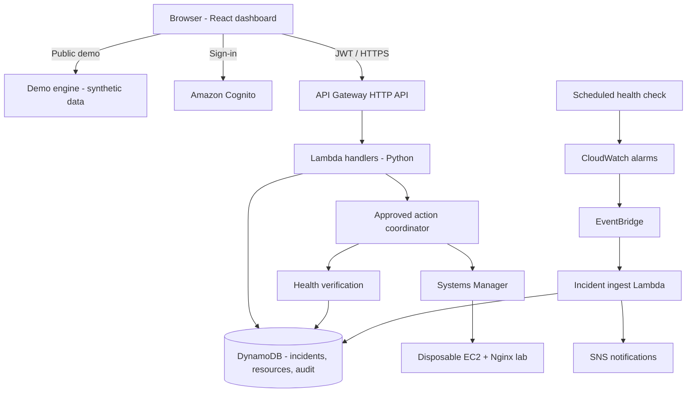

<div align="center">

<picture>
  <source media="(prefers-color-scheme: dark)" srcset="brand/opsentra-logo-dark.svg">
  <source media="(prefers-color-scheme: light)" srcset="brand/opsentra-logo-light.svg">
  
</picture>

### Monitor. Detect. Respond. Recover.

A UI-first cloud operations and incident response platform for AWS infrastructure.


</div>

> [!WARNING]
> **Opsentra is a work in progress.** The project is in **Phase 3: AWS infrastructure foundation**. The brand identity, the dashboard foundation (Phase 1) and a fully interactive **Demo Mode** with Easy and Advanced views (Phase 2) are complete. Backend services and AWS infrastructure **have not been built or deployed yet**. Live AWS Mode is not connected and shows an error instead of data. Apart from Demo Mode, everything below describes the planned design from the [master blueprint](OPSENTRA_MASTER_BLUEPRINT.md), not working features.

---

## What is Opsentra?

Opsentra helps IT administrators, cloud engineers and operations teams **monitor AWS infrastructure, detect incidents, investigate them, and run controlled, approved recovery workflows**, all from one web interface, with no AWS Console hopping and no terminal required for the demo.

Its mission: **make cloud infrastructure easier to observe, understand, and recover.**

The project is also a portfolio piece that demonstrates practical cloud engineering: Infrastructure as Code, serverless architecture, event-driven incident detection, least-privilege security, observability and cost discipline.

### The scenario

Opsentra is designed around **HarborPoint Solutions**, a *fictional* ~200-person organization with a lean IT team and three sandbox workloads:

| Workload | AWS services | What can go wrong |
|---|---|---|
| Corporate web server | EC2, Amazon Linux, Nginx | Nginx stops responding while the instance keeps running |
| Ticketing API | API Gateway, Lambda, DynamoDB | A new Lambda version raises 5xx errors |
| Document repository | S3 | Misconfiguration or failed access checks |

---

## Planned capabilities

| Capability | What it will do |
|---|---|
| **Infrastructure monitoring** | Health and status of registered EC2, Lambda, API Gateway, DynamoDB and S3 resources |
| **Incident detection** | CloudWatch alarms → EventBridge → idempotent incident creation, with deduplication and out-of-order event handling |
| **Incident management** | Severity, ownership, lifecycle states, evidence and a full audit timeline |
| **Controlled remediation** | Allowlisted, versioned runbooks (e.g. restart Nginx via Systems Manager) that require admin approval and are **only marked resolved after independent health verification** |
| **Simulation Lab** | Trigger safe, tagged, disposable failures from the UI and watch the whole lifecycle play out |
| **Analytics** | MTTA, MTTR, availability, severity distribution and runbook success, with honest denominators |
| **Demo Mode & Live AWS Mode** | A public, clearly labeled synthetic demo, separate from the authenticated live AWS mode |

### The incident lifecycle

```text
Failure → Detection → Incident → Investigation → Approval → Remediation → Recovery (verified)
```

The core demonstration, and the first one that will be built end to end, is a **real Nginx outage on EC2, detected by CloudWatch, recovered through the web UI via an approved SSM runbook, and verified by repeated health checks.** Lambda rollback and security-group exposure scenarios are planned as stretch goals.

---

## Planned architecture



| Plane | Contents | Lifetime |
|---|---|---|
| Frontend Demo | Static GitHub Pages build with synthetic data | Persistent, no AWS credentials |
| Control plane | Cognito, API Gateway, Lambda, DynamoDB, EventBridge, SNS | Long-lived, least privilege |
| Lab plane | Disposable EC2/Nginx, Lambda regression, test security group | Created only for tests, then destroyed |
| Terraform state | Versioned, encrypted S3 bucket with native locking | Persistent, never public |

### Tech stack

| Area | Technologies |
|---|---|
| Frontend | React, Vite, TypeScript, Tailwind CSS, shadcn/ui |
| Backend | Python, AWS Lambda, API Gateway HTTP API (REST, `/v1`) |
| Data | Amazon DynamoDB (on-demand) |
| Detection & events | Amazon CloudWatch, Amazon EventBridge, AWS CloudTrail, Amazon SNS |
| Remediation | AWS Systems Manager (Run Command / Automation) |
| Identity | Amazon Cognito, IAM (Viewer / Operator / Administrator roles) |
| Infrastructure as Code | Terraform (S3 backend with native lockfile) |
| CI/CD | GitHub Actions with short-lived AWS OIDC credentials, GitHub Pages |
| Testing | Vitest, Testing Library, pytest, Playwright, Terraform validate/fmt + security scanning |

---

## Design principles

- **UI-first, but engineering-real:** the browser drives the demo, and every live claim is backed by real AWS evidence.
- **Demo and Live are never mixed:** synthetic data is always labeled `DEMO — SYNTHETIC DATA`, and Live Mode fails closed instead of quietly falling back to mock data.
- **Safe by construction:** no arbitrary commands, no generic "terraform apply" button, no SSH. Only allowlisted runbooks run against tagged lab resources.
- **Backend-enforced authorization:** Cognito JWTs plus server-side role checks; UI roles alone are never trusted.
- **Terraform-first and disposable:** labs are created for a demo and destroyed afterwards.
- **Cost-aware:** no NAT gateways, load balancers, RDS or always-on containers in the MVP. The control plane targets a few dollars a month at low traffic (a planning target, not a guarantee).
- **One complete incident before breadth:** the Nginx failure-to-verified-recovery flow comes first.

---

## Roadmap

Work progresses through **ten milestone-based phases**. Each one has to pass its gate before the next begins.

| # | Phase | Status |
|---|---|---|
| 1 | Branding approval, foundation, UI/UX | ✅ Complete |
| 2 | Fully interactive Demo Mode | ✅ Complete |
| 3 | AWS infrastructure foundation (Terraform, Cognito, API, DynamoDB) | 🟡 **In progress** |
| 4 | Real AWS monitoring and inventory | ⚪ Planned |
| 5 | Incident detection, management and audit | ⚪ Planned |
| 6 | Controlled automated remediation | ⚪ Planned |
| 7 | Live Simulation Lab and guardrails | ⚪ Planned |
| 8 | Analytics, reporting and observability | ⚪ Planned |
| 9 | Security hardening, testing and optimization | ⚪ Planned |
| 10 | Public release, docs and portfolio case study | ⚪ Planned |

**Done so far**

- [x] Project master blueprint: scope, architecture, security model, test plan, cost strategy
- [x] Brand identity: logo system, favicons, colour and type guidelines ([`brand/`](brand/))
- [x] React + TypeScript dashboard foundation and page skeletons ([`apps/dashboard/`](apps/dashboard/))
- [x] Interactive Demo Mode: simulated failure → detection → approval → verified recovery, with audit and analytics
- [x] Easy and Advanced views: plain-language Easy view by default, full Advanced view one click away
- [ ] AWS infrastructure and live workflows

---

## Repository

```text
opsentra/
├── README.md
├── CLAUDE.md                      # guardrails for building with Claude Code
├── OPSENTRA_MASTER_BLUEPRINT.md   # source of truth: scope, architecture, phases
├── .github/                       # frontend CI, PR template
├── apps/dashboard/                # React + Vite + TypeScript dashboard (Phase 1 foundation)
├── brand/                         # logo system, favicons, brand guidelines
└── docs/                          # ADRs, architecture overview, phase checkpoints
```

Backend services (`services/`), Terraform (`infrastructure/`), failure labs (`labs/`) and integration tests will be added in the phases where they are built. See §8 of the [blueprint](OPSENTRA_MASTER_BLUEPRINT.md) for the planned layout.

## Brand


The **Continuity Shift** symbol is one ring split into two halves that shift apart but never separate: an incident is a shift in a system that stays whole. The full kit and usage rules are in [`brand/BRAND_GUIDELINES.md`](brand/BRAND_GUIDELINES.md).

<br clear="left">

### Run the dashboard locally

```bash
cd apps/dashboard
npm ci
npm run dev        # http://localhost:5173 (Demo Mode, synthetic data)
# Opens in the Easy view: Practice lab → Break the web server, then follow the one button.
# Switch to Advanced (top bar) for the full engineering view.
npm test           # unit and component tests
```

See [`apps/dashboard/README.md`](apps/dashboard/README.md) for all scripts.

## Documentation

- [Master blueprint](OPSENTRA_MASTER_BLUEPRINT.md): architecture, API contract, data model, threat model, test strategy, cost plan and interview storyboard
- [Architecture overview](docs/architecture/overview.md): what is built now versus planned
- [Architecture decision records](docs/adr/)
- [Phase 1 checkpoint](docs/phases/phase-1-checkpoint.md), [design review](docs/phases/phase-1-design-review.md) and [Phase 2 checkpoint](docs/phases/phase-2-checkpoint.md)
- [Brand guidelines](brand/BRAND_GUIDELINES.md): logo usage, colour, typography and dashboard branding

## Author

Opsentra is created and programmed solely by **Jervil Angelo De Leon**: concept, architecture, brand, infrastructure and code.

- Website: [jervilangelo.online](https://jervilangelo.online)
- GitHub: [github.com/jervilangelo](https://github.com/jervilangelo)

## License

A license has not been chosen yet. Until one is added, all rights are reserved.

---

<div align="center">
<sub>Created and developed by <a href="https://jervilangelo.online">Jervil Angelo De Leon</a>.<br>
Opsentra is a portfolio project under active development. HarborPoint Solutions is fictional. No real customer data is used.</sub>
</div>
