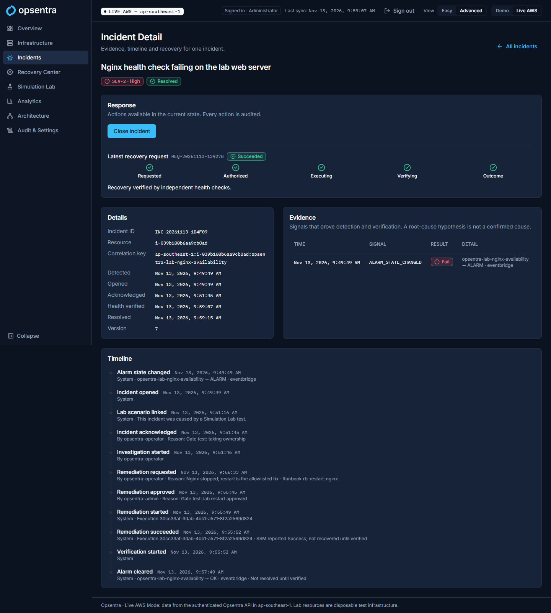
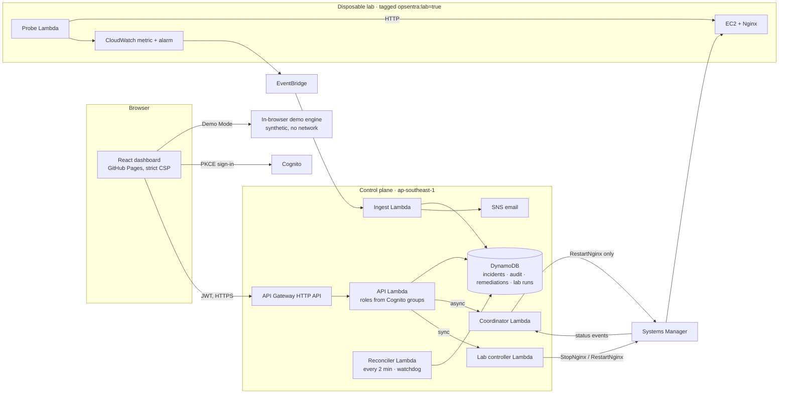
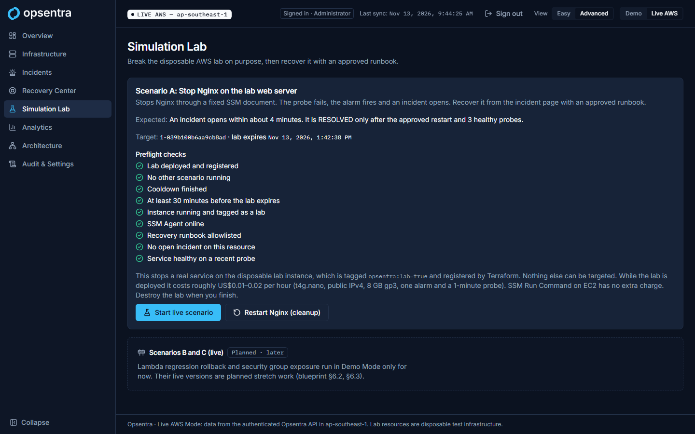
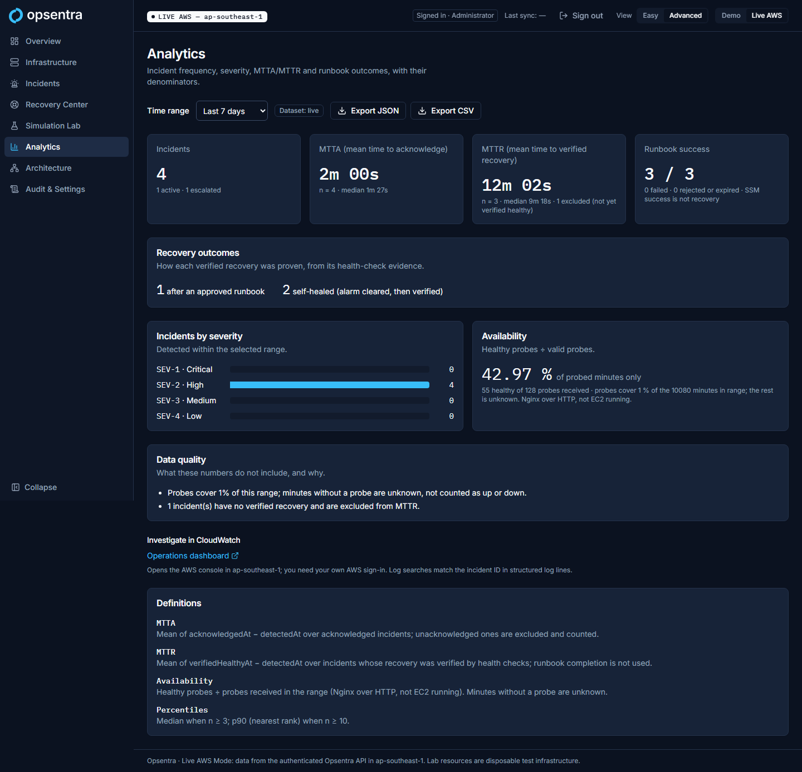
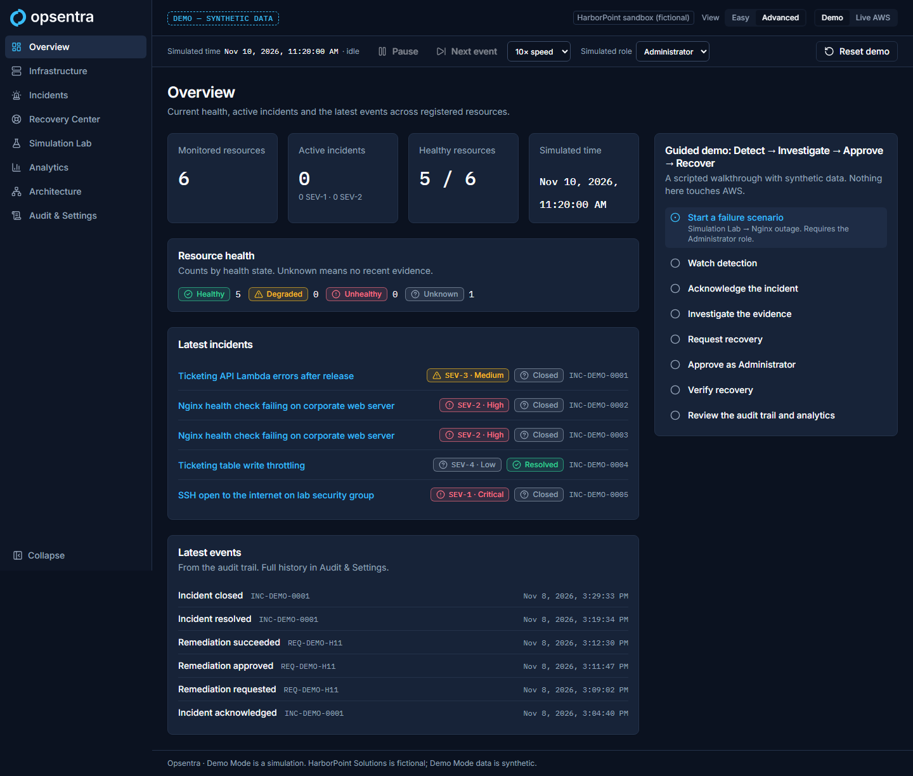
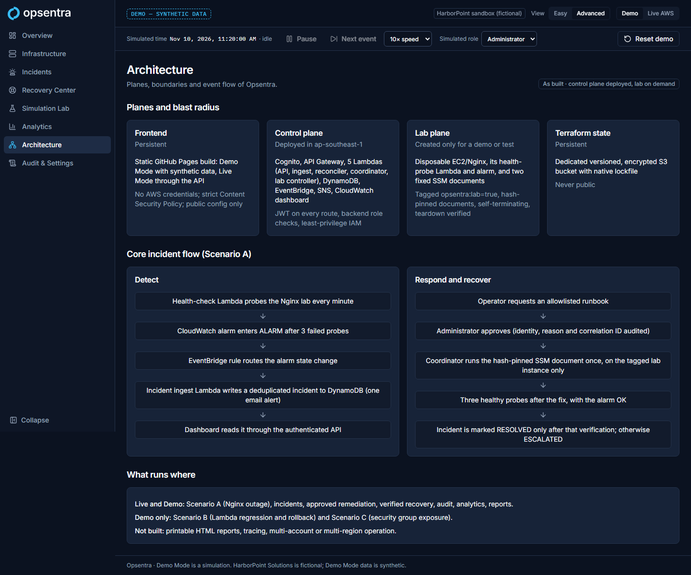

<div align="center">

<picture>
  <source media="(prefers-color-scheme: dark)" srcset="brand/opsentra-logo-dark.svg">
  <source media="(prefers-color-scheme: light)" srcset="brand/opsentra-logo-light.svg">
  
</picture>

### Monitor. Detect. Respond. Recover.

A UI-first cloud operations and incident response platform for AWS.

**[▶ Try the live demo](https://jervilangelo.github.io/opsentra/)** · no sign-in needed · synthetic data, clearly labelled


</div>

---

## What it is

Opsentra lets an operations team **watch AWS workloads, detect an outage, investigate it, and run an approved, audited recovery**, all from one web app, with no terminal and no console hopping. An incident is closed only when independent health checks prove the service works again, not when a command reports "Success".

It is a portfolio project that is **real where it says so**: the Live mode runs against AWS infrastructure built with Terraform, and every live claim below was tested against that infrastructure. The public site runs the **Demo Mode**, a deterministic simulation of the same workflow that needs no account and calls no AWS endpoint.

<p align="center">
  
  <br><sub>Live AWS Mode: a real Nginx outage, recovered by an approved runbook and resolved only after the probe verified health.</sub>
</p>

## Two modes, never mixed

| | **Demo Mode** (public) | **Live AWS Mode** (authenticated) |
|---|---|---|
| Who | Anyone, no sign-in | Cognito users in the `viewer`, `operator` or `admin` group (no self sign-up) |
| Data | Deterministic synthetic data, labelled `DEMO — SYNTHETIC DATA` on every screen and export | The Opsentra API in `ap-southeast-1`, labelled `LIVE AWS — ap-southeast-1` |
| AWS calls | None (enforced by tests) | JWT-authorised API only |
| If something fails | n/a | Fails closed: shows an error, never substitutes demo data |

## What works

| Capability | Live AWS | Demo | Evidence |
|---|---|---|---|
| Monitoring of a disposable EC2/Nginx lab: HTTP probe every minute, CloudWatch metric and alarm | ✅ | ✅ | [Phase 4](docs/adr/ADR-015-phase4-lab-and-live-adapter.md) |
| Incident detection: alarm → EventBridge → deduplicated incident, one SNS alert per incident (email delivery needs the subscription confirmed), reconciler for missed events | ✅ | ✅ | [Phase 5 checkpoint](docs/phases/phase-5-checkpoint.md) |
| Incident workflow: acknowledge, investigate, append-only audit trail, denied attempts recorded | ✅ | ✅ | [ADR-016](docs/adr/ADR-016-incident-pipeline.md) |
| Approved remediation: operator requests an allowlisted, hash-pinned SSM runbook; admin approves; it runs exactly once | ✅ | ✅ | [Phase 6 checkpoint](docs/phases/phase-6-checkpoint.md) |
| Verified recovery: RESOLVED only after 3 healthy probes after the fix; SSM "Success" with the service still down → ESCALATED | ✅ | ✅ | Live false-success test, Phase 6 |
| Simulation Lab, Scenario A (Nginx outage): preflight checks, one-run lock, cooldown, time limit, watchdog, reset | ✅ | ✅ | [Phase 7 checkpoint](docs/phases/phase-7-checkpoint.md) |
| Scenario B (Lambda regression rollback) and C (security group exposure) | — | ✅ | Demo only, labelled planned in Live |
| Analytics: MTTA/MTTR with medians and denominators, runbook and recovery outcomes, availability with coverage (unknown when there is no data) | ✅ | ✅ | [Phase 8 checkpoint](docs/phases/phase-8-checkpoint.md): every Live number reconciled with its source |
| Sanitized JSON/CSV incident and analytics reports | ✅ | ✅ | No account IDs or ARNs (tested) |
| Structured logs, CloudWatch operations dashboard, investigation links | ✅ | — | [ADR-019](docs/adr/ADR-019-analytics-and-observability.md) |
| Easy and Advanced views, dark and light themes, WCAG 2.2 AA | ✅ | ✅ | axe on every Demo and Live screen |
| Printable HTML report, tracing, multi-account or multi-region | ❌ | ❌ | Not built |

## Architecture



| Plane | What it holds | Lifetime |
|---|---|---|
| Frontend | Static build on GitHub Pages: Demo Mode, and Live Mode through the API | Persistent; no AWS credentials |
| Control plane | Cognito, API Gateway, 5 Lambdas, DynamoDB, EventBridge, SNS, CloudWatch dashboard | Deployed; serverless, no always-on compute |
| Lab plane | EC2/Nginx, its probe and alarm, two fixed SSM documents | Created for a demo, destroyed after (teardown verified by script) |
| Terraform state | Versioned, encrypted S3 bucket with native locking | Persistent, never public |

More: [architecture overview](docs/architecture/overview.md) · [IAM model](docs/security/iam-model.md) · [ADRs](docs/adr/).

## Security, in short

- **No arbitrary actions.** Requests carry only a runbook or scenario ID. Targets and documents come from a Terraform-written registry, pinned by SHA-256 hash, and only on instances tagged `opsentra:lab=true`. This is enforced in IAM and checked again in code.
- **Backend-enforced roles.** Roles come from Cognito groups, never from a request. Every route except `/v1/health` needs a JWT. Writes need an `Idempotency-Key` and a version check.
- **Least privilege, tested.** Terraform tests pin every IAM policy. IAM Access Analyzer reports no findings. The coordinator cannot run the fault-injection document.
- **Phase 9 audit:** no critical or high findings. The checks cover secrets across the full git history, dependencies, TLS/CORS, auth on every route, input fuzzing and a CSP. See the [test report](docs/phases/phase-9-test-report.md) and the [threat model](docs/security/threat-model.md).

## Costs

The control plane is serverless and mostly within free tiers. The lab costs about **US$0.01–0.02 per hour** while it exists, and it exists only during tests. Observed usage for 1–13 November 2026, the whole build and test period: **≈ US$0.035**. See the [cost log](docs/costs/cost-log.md).

## See it

| | |
|---|---|
|  |  |
| **Live:** Simulation Lab preflight | **Live:** analytics, reconciled with source data |
|  |  |
| **Demo:** overview | **Demo:** architecture as built |

🎬 **[Demo walkthrough video](docs/media/opsentra-demo-walkthrough.webm)** (Demo Mode, synthetic data): break the web server, take ownership, approve the fix, and watch it verified.

## Run it

**Demo locally** (no AWS):

```bash
cd apps/dashboard && npm ci && npm run dev   # http://localhost:5173
```

**Live, on your own AWS account.** This needs Terraform ≥ 1.10 (S3 native state locking), the AWS CLI and Python 3.12:

1. Bootstrap the state bucket: [`infrastructure/bootstrap-state/`](infrastructure/bootstrap-state/).
2. Deploy the control plane: [`infrastructure/environments/control-plane-dev/`](infrastructure/environments/control-plane-dev/), using `terraform.tfvars.example` as the template.
3. Create Cognito users in the `viewer`, `operator` or `admin` group.
4. Put the four public `VITE_*` values in `apps/dashboard/.env.local`.
5. Deploy the lab only when you need it, and destroy it after. See [runbooks §1–2](docs/operations/runbooks.md).

Full steps: [Terraform operations](docs/operations/terraform.md). Live demo script and checklist: [interview demo](docs/interview-demo/README.md).

## Repository

```text
apps/dashboard/        React + Vite + TypeScript dashboard (Demo engine, Live adapter)
services/api/          API Lambda (/v1), analytics
services/incidents/    ingest, reconciler, remediation coordinator, lab controller, structured logs
services/health-check/ the lab's independent HTTP probe
infrastructure/        Terraform: state bootstrap, control plane, disposable lab, modules (+ mocked tests)
scripts/gate/          live gate drivers (UI and API), teardown verification, analytics reconciliation
scripts/security/      secret scan, API security probe, latency check
scripts/release/       bundle and site checks, demo recording
docs/                  ADRs, phase checkpoints, threat model, runbooks, costs, interview demo
OPSENTRA_MASTER_BLUEPRINT.md   source of truth: scope, design, phases
```

## How it was built

Ten gated phases, each with a written gate, tests and evidence, and an owner review before the next phase began. See the [roadmap and changelog](CHANGELOG.md), the [phase checkpoints](docs/phases/) and the [master blueprint](OPSENTRA_MASTER_BLUEPRINT.md). Bugs found in live testing are written down with their fixes, for example the invalid DynamoDB update that a mock accepted, and a CORS preflight regression caught by the accessibility gate.

## Author

Created and programmed solely by **Jervil Angelo De Leon**: concept, architecture, brand, infrastructure and code.

- Website: [jervilangelo.online](https://jervilangelo.online)
- GitHub: [github.com/jervilangelo](https://github.com/jervilangelo)

## License

A license has not been chosen yet. Until one is added, all rights are reserved.

---

<div align="center">
<sub>HarborPoint Solutions, the demo's organisation, is fictional. No real customer data is used. The Live lab is disposable test infrastructure.</sub>
</div>
