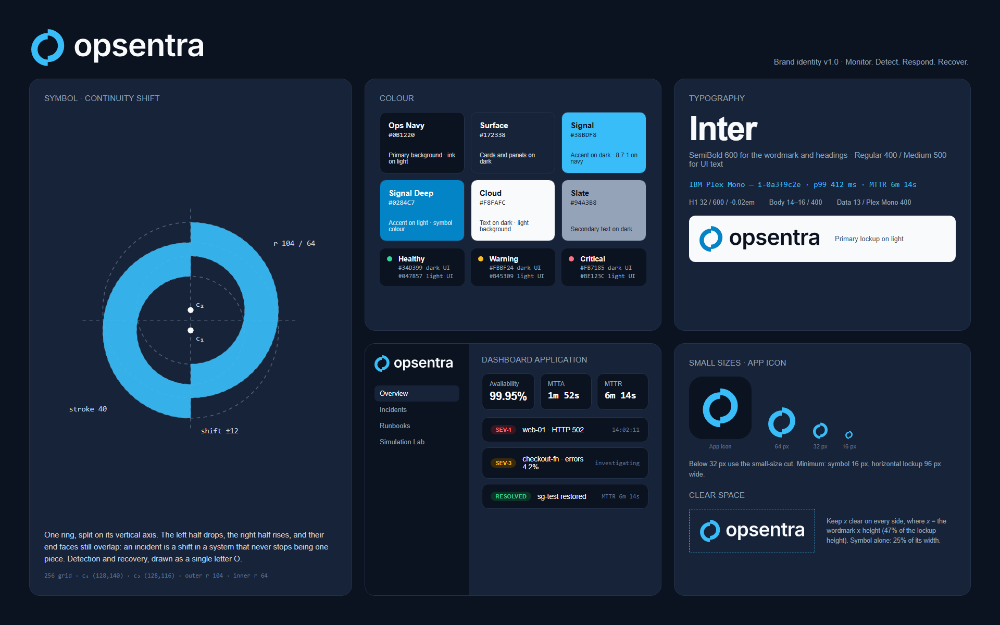

# Opsentra Brand Guidelines

**Version 1.0 · November 2026**
**Tagline:** Monitor. Detect. Respond. Recover.



---

## 1. Logo concept: Continuity Shift

The symbol is one ring split along its vertical axis. The left half drops 12 units and the right half rises 12 units. Their end faces still overlap, so the ring never comes apart.

- **The ring** is the infrastructure Opsentra watches: continuous and closed.
- **The shift** is the incident, the moment the system leaves its normal state.
- **The overlap** is the promise: the system shifts, but it never stops being one piece. Detection (left half) and recovery (right half) stay connected.
- **The letter O** begins the name, so the symbol works as a monogram.

It is deliberately not a heartbeat, a shield, a cloud, a radar or a network of dots.

### Construction (256-unit grid)

| Element | Value |
|---|---|
| Outer radius | 104 |
| Inner radius | 64 (stroke 40) |
| Left half centre (c₁) | (128, 140): shifted down 12 |
| Right half centre (c₂) | (128, 116): shifted up 12 |
| End-face overlap | 16 of 40 units (40 %) |
| Small-size cut | outer r 112, stroke 42, shift 12 (fills the canvas for ≤ 32 px) |

The overlap was tuned on purpose. At 100 % offset (halves touching only at a corner), small sizes read as a "sync/refresh" UI icon. At 40 % overlap the mark reads as a single sheared O.

### Wordmark

The wordmark is lowercase **opsentra** in Inter SemiBold (600), outlined to paths, with the font's own kerning and −0.02 em tracking. Lowercase feels approachable and technical (CLI-like) without looking playful. Never retype the wordmark in a live font: always use the supplied SVGs.

### Lockup

- The symbol is scaled to 0.66 × the master and centred on the wordmark's x-height band, not on the full text box.
- The gap between symbol and wordmark is 0.32 × the symbol width.
- Proportions are fixed. Never rearrange or rescale the parts independently.

---

## 2. Files

| File | Use |
|---|---|
| `opsentra-logo-primary.svg` | Default horizontal logo (Signal Deep symbol + Ops Navy wordmark), transparent background |
| `opsentra-logo-light.svg` | For light backgrounds. Same colours as primary; provided so light/dark pairs can be named explicitly |
| `opsentra-logo-dark.svg` | For dark backgrounds (Signal symbol + Cloud wordmark), transparent |
| `opsentra-monochrome.svg` | One colour, black: print, stamps, fax-quality contexts |
| `opsentra-icon.svg` | Symbol only, Signal Deep |
| `favicon.svg` | Small-size cut. Switches to Signal on dark browser themes via `prefers-color-scheme` |
| `favicon.ico` | 16 / 32 / 48 px, legacy browsers |
| `opsentra-logo-preview.png` | All logo versions at a glance |
| `opsentra-brand-board.png` | One-page identity overview |
| `opsentra-github-social-preview.png` | 1280 × 640 GitHub repository social preview |
| `variants/` | White monochrome, dark-tile logo, icon in dark / black / white, small cut, wordmark only, app icon, static favicon |
| `web/` | Full web icon set: favicon PNGs, `apple-touch-icon.png`, `icon-192/512.png`, `maskable-512.png`, `site.webmanifest`, `head-snippet.html` |
| `source/` | `build_kit.py` (vector source of truth) and `boards.py` (board HTML sources) |

All SVGs are pure vector paths: no live text, no embedded rasters, no filters or masks.

---

## 3. Colour

### Core palette

| Name | HEX | RGB | Role |
|---|---|---|---|
| **Ops Navy** | `#0B1220` | 11 18 32 | Primary dark background; ink on light |
| **Surface** | `#172338` | 23 35 56 | Cards and panels on dark |
| **Line** | `#24324A` | 36 50 74 | Borders and dividers on dark |
| **Signal** | `#38BDF8` | 56 189 248 | Brand accent on dark backgrounds |
| **Signal Deep** | `#0284C7` | 2 132 199 | Brand accent on light backgrounds; primary symbol colour |
| **Signal Ink** | `#0369A1` | 3 105 161 | Accent *text* and links on light backgrounds (AA for body text) |
| **Cloud** | `#F8FAFC` | 248 250 252 | Text on dark; light background |
| **Slate** | `#94A3B8` | 148 163 184 | Secondary text on dark |
| **Slate Ink** | `#475569` | 71 85 105 | Secondary text on light |

**Why the palette was refined:** your starting cyan `#38BDF8` is excellent on navy (8.7:1) but fails on white (2.1:1). Signal Deep `#0284C7` carries the same hue onto light surfaces (4.1:1, above the 3:1 needed for graphics), and Signal Ink covers accent text that must meet 4.5:1.

### Status colours

Status colours belong to the product UI, not the logo. Each status has a dark-UI and a light-UI value so it stays legible on both.

| Status | Dark UI | on Ops Navy | Light UI | on white |
|---|---|---|---|---|
| Healthy / resolved | `#34D399` | 9.7:1 | `#047857` | 5.5:1 |
| Warning | `#FBBF24` | 11.2:1 | `#B45309` | 5.0:1 |
| Critical | `#FB7185` | 7.0:1 | `#BE123C` | 6.3:1 |
| Info | `#38BDF8` (Signal) | 8.7:1 | `#0369A1` (Signal Ink) | 5.9:1 |

**Never use colour alone to show status.** Pair it with a label (`SEV-1`, `RESOLVED`), an icon or a shape.

### Proportion

The identity is mostly navy and neutral. Signal is a highlight: the symbol, the active state, the primary action. A good rule of thumb is about 70 % neutrals, 20 % surface tones and 10 % Signal.

---

## 4. Typography

| Role | Typeface | Weight | Notes |
|---|---|---|---|
| Wordmark | Inter (outlined) | SemiBold 600 | Supplied as paths only |
| Headings | Inter | SemiBold 600 | Tracking −0.02 em at 24 px and above |
| UI and body | Inter | Regular 400 / Medium 500 | 14–16 px, line-height 1.5 |
| Data, IDs, logs, timestamps | IBM Plex Mono | Regular 400 / Medium 500 | Resource IDs, metrics, durations, code |

Both typefaces are free under the SIL Open Font License and available on Google Fonts. Use tabular numerals (`font-variant-numeric: tabular-nums`) for live metrics so values do not jitter as they update.

```css
--font-sans: "Inter", ui-sans-serif, system-ui, sans-serif;
--font-mono: "IBM Plex Mono", ui-monospace, SFMono-Regular, monospace;
```

---

## 5. Clear space and minimum sizes

**Clear space.** Let *x* be the wordmark's x-height (≈ 47 % of the horizontal logo's height). Keep at least *x* clear on all sides of the horizontal logo. For the symbol alone, keep 25 % of the symbol's width clear on all sides.

| Asset | Minimum (screen) | Minimum (print) |
|---|---|---|
| Horizontal logo | 96 px wide | 25 mm wide |
| Symbol (master) | 32 px | 8 mm |
| Symbol (small-size cut) | 16 px | 5 mm |

Below 32 px, use the small-size cut (`variants/opsentra-icon-small.svg` / `favicon.svg`).

---

## 6. Light and dark usage

| Background | Use |
|---|---|
| White, Cloud, light greys | `opsentra-logo-primary.svg` / `-light.svg` |
| Ops Navy, Surface, dark greys | `opsentra-logo-dark.svg` |
| Pure black | `variants/opsentra-monochrome-white.svg` or the dark logo |
| Photography or busy imagery | Monochrome white on a darkened area, or place the logo on an Ops Navy panel |
| One-colour print | `opsentra-monochrome.svg` (or a single spot colour) |

On dark backgrounds, white artwork looks slightly heavier (irradiation). For large reversed uses (signage, slides at full-screen size), the dark logo with the Signal symbol is preferred over solid white.

---

## 7. Incorrect usage

Do not:

1. Recolour the symbol in status colours (red, amber, green). The logo is not a status indicator.
2. Split the symbol into two colours. Two tones pull the halves apart and the mark starts to read as a refresh icon.
3. Re-align the two halves, rotate the symbol or mirror it. The left half is always the lower one.
4. Add gradients, glows, shadows, bevels, outlines or 3D effects.
5. Retype the wordmark, change its font or weight, or switch it to uppercase or title case.
6. Stretch, condense or skew the logo, or change the symbol-to-wordmark proportion.
7. Place the logo on low-contrast backgrounds (for example the Signal logo on mid-blue).
8. Put the symbol inside another shape (shield, cloud, hexagon) except the approved rounded-square app icon.
9. Use the symbol as a loading spinner or animate it spinning. Motion should express the shift (see §9), not rotation.
10. Crowd the logo inside its clear space.

---

## 8. Favicon and app icons

- **Browser tab:** `favicon.svg` (adaptive: Signal Deep on light tab strips, Signal on dark), with `favicon.ico` as fallback.
- **iOS / PWA:** `web/apple-touch-icon.png`, `web/icon-192.png`, `web/icon-512.png` and `web/maskable-512.png`. The maskable icon keeps the symbol inside the safe zone.
- **App icon:** `variants/opsentra-app-icon.svg`: Signal symbol at 64 % on an Ops Navy rounded square (radius 56/256).
- **GitHub organisation / avatar:** use `web/icon-512.png` (navy tile). It reads well inside GitHub's circular crop.
- Paste `web/head-snippet.html` into the app's `<head>` and copy the `web/` files to the site root.

---

## 9. Dashboard branding (React + Tailwind + shadcn/ui)

**Default theme: dark.** Operators often work long sessions and incident rooms. The light theme mirrors it using the light-UI colour values.

```css
:root {                                  /* light */
  --background: 210 40% 98%;             /* #F8FAFC Cloud */
  --foreground: 220 49% 8%;              /* #0B1220 Ops Navy */
  --primary: 201 96% 32%;                /* #0369A1 Signal Ink (ADR-011: white text 5.9:1) */
  --ring: 200 98% 39%;                   /* #0284C7 Signal Deep */
}
.dark {
  --background: 220 49% 8%;              /* #0B1220 Ops Navy */
  --card: 218 42% 15%;                   /* #172338 Surface */
  --border: 218 34% 22%;                 /* #24324A Line */
  --foreground: 210 40% 98%;             /* #F8FAFC Cloud */
  --muted-foreground: 215 20% 65%;       /* #94A3B8 Slate */
  --primary: 199 93% 60%;                /* #38BDF8 Signal */
  --primary-foreground: 220 49% 8%;
  --ring: 199 93% 60%;
}
```

- **Sidebar header:** horizontal dark logo, 28–32 px tall. When the sidebar is collapsed, show the symbol at 24 px using the small-size cut.
- **Signal is for brand and primary actions only.** Never use it for a status. Healthy, Warning and Critical keep their own colours.
- **Severity badges:** a text label (`SEV-1`) on a tinted background with a coloured border or dot, never colour alone.
- **Data:** resource IDs, ARNs, metrics and timestamps in IBM Plex Mono with tabular numerals.
- **Demo vs Live mode:** label the mode at all times. Demo Mode uses a dashed Signal outline badge (`DEMO — SYNTHETIC DATA`, standardised by ADR-011). Live AWS Mode uses a solid badge with a dot. Never tint the logo to show the mode.
- **Motion:** for loading or "recovering" states, animate the right half sliding 12 units into alignment and back (200–300 ms ease-out). That is the brand's own motion. Avoid spinning the mark. Respect `prefers-reduced-motion`.
- **Empty and healthy states:** a large, low-opacity (6–8 %) symbol works as a quiet watermark, as on the GitHub social preview.

---

## 10. Legal and open items

- **Name.** A web search found no existing "Opsentra" product. Nearby names in the same market include Opsview, OpsRamp, Opsera and Opsio, and the "-sentra" part sits close to Sentry and Microsoft Entra. This is not legal clearance: run a trademark search (USPTO, EUIPO, your local IP office) and a reverse-image search before any commercial or public launch.
- **Fonts.** Inter and IBM Plex Mono are licensed under the SIL OFL 1.1, which permits use in logos and outlining. The font files are not redistributed in this kit.
- **Masters.** SVG is the master format. PDF/EPS/AI versions were not produced because no vector editor was available. They can be exported from the SVGs in Illustrator, Inkscape or Figma.
- **Pantone / CMYK.** Not specified yet. Match on press proofs if print is ever needed.
