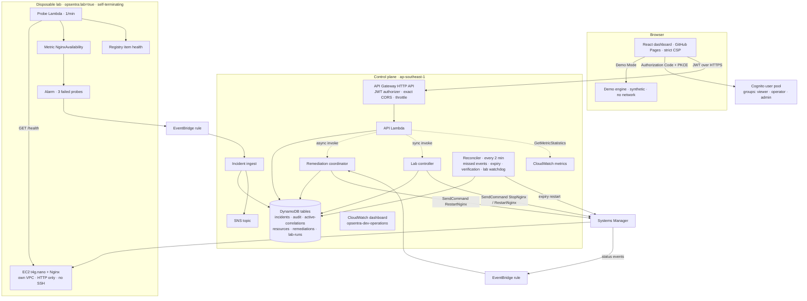
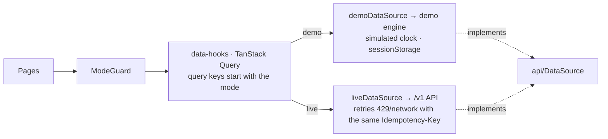

# Architecture overview (as built, v1.0.0)

Opsentra is a React dashboard with two strictly separated data sources: an in-browser Demo engine, and an authenticated serverless API on AWS. A disposable lab gives the system something real to break and fix. This page describes what is deployed and tested. The design reasoning is in the [master blueprint §3](../../OPSENTRA_MASTER_BLUEPRINT.md#3-architecture-and-boundaries) and the [ADRs](../adr/).

## System

### Planes

| Plane | Contents | Lifetime | Posture |
|---|---|---|---|
| Frontend | Static build on GitHub Pages | Persistent | No AWS credentials; only the public `VITE_*` config; strict CSP |
| Control plane | Cognito, API Gateway, 5 Lambdas, 6 DynamoDB tables, EventBridge targets, SNS, SQS DLQs, dashboard | Deployed | JWT on every route except `/v1/health`; least-privilege IAM, pinned by Terraform tests |
| Lab plane | VPC, EC2/Nginx, probe Lambda and schedule, alarm, two SSM documents, registry items | Created for a demo; destroyed after | Tagged `opsentra:lab=true` and `opsentra:expiresAt`; self-terminates; teardown verified by script |
| Terraform state | S3 bucket, versioning, SSE, TLS-only policy, native lockfile | Persistent | Never public |

### Key flows

| Flow | Path | Guarantees |
|---|---|---|
| Detect | probe → metric → alarm → EventBridge → ingest → DynamoDB | Deduplicated by event ID and correlation key; one SNS publish per incident; the reconciler opens any incident whose event was missed |
| Respond | operator request → admin decision → coordinator → SSM | Runbook and document come from the registry, hash-pinned; one command per approval (conditional lock); every step audited; refusals audited `*_DENIED` |
| Verify | SSM status → VERIFYING → reconciler checks the probe | RESOLVED only with 3 healthy probes after the fix and the alarm OK; otherwise ESCALATED after 10 minutes |
| Break (Simulation Lab) | admin → API → lab controller → SSM StopNginx | 9 preflight checks; one run at a time; 5-minute cooldown; 45-minute limit; the watchdog resets, links or ends runs |
| Measure | API → DynamoDB + CloudWatch metric | Same definitions as Demo; denominators shown; unknown when there is no data |

## Frontend

Rules the code enforces:

- **One read path.** Pages read and write only through `DataSource` (`src/api/data-source.ts`), whose methods map to the §4.2 routes. Responses are `{data, meta}`, with `meta.dataset` set to `synthetic` or `live`.
- **No mixing.** `modes/demo` and `modes/live` cannot import each other (ESLint). Query keys start with the mode. Exports name their dataset in the first line and in the file name.
- **Fail closed.** In Live mode, `ModeGuard` shows sign-in or "not connected", never page data. `liveDataSource` rejects on any auth, network or HTTP error.
- **Demo never calls out.** A unit test spies on `fetch`/XHR, and the E2E suite fails on any non-local request.
- **Shared domain logic.** `src/domain/` holds the incident state machine and the §4.5 analytics; the Python API implements the same definitions, pinned by a parity test.
- **Persistent mode banner.** `DEMO — SYNTHETIC DATA` or `LIVE AWS — ap-southeast-1` appears on every page.

## Routes

| Path | Page | Notes |
|---|---|---|
| `/` | Overview | Counts, health, latest incidents; guided walkthrough in Demo |
| `/infrastructure` | Infrastructure | Registered resources and probe health |
| `/incidents`, `/incidents/:id` | Incidents, Incident Detail | Actions by state and role, recovery progress, evidence, timeline, report export, CloudWatch links (Live) |
| `/recovery` | Recovery Center | Runbook catalogue and requests |
| `/simulation-lab` | Simulation Lab | Live: Scenario A with preflight, run panel and reset (admin). Demo: Scenarios A, B, C |
| `/analytics` | Analytics | MTTA/MTTR, outcomes, availability with coverage, data-quality notes, export |
| `/architecture` | Architecture | This system as built |
| `/audit` | Audit & Settings | Append-only audit (admin in Live), theme, view, identity |
| `/sign-in` | Sign in | Cognito hosted UI when the build has Live config |
