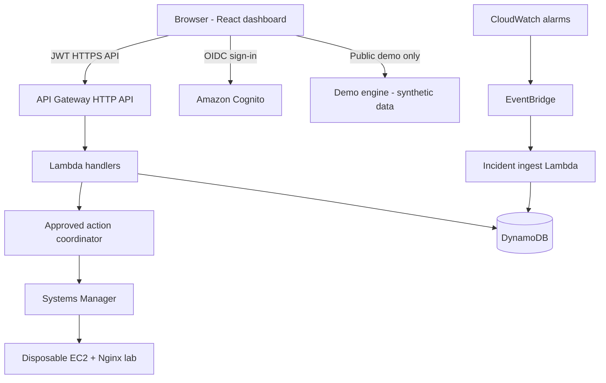
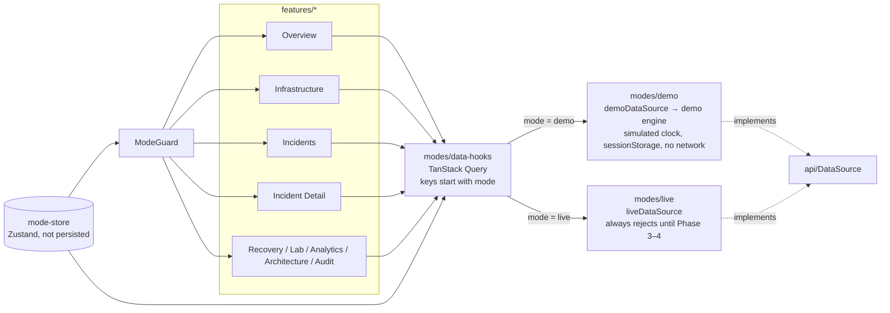

# Architecture overview

This page links to the planned system in the [master blueprint §3](../../OPSENTRA_MASTER_BLUEPRINT.md#3-architecture-and-boundaries) and describes the frontend as built.

**Built and deployed (Phases 3–5):** Cognito, the HTTP API with JWT roles, Lambda handlers and DynamoDB (ADR-014); the disposable EC2/Nginx lab with its probe, metric, alarm and EventBridge rule (ADR-015); and the incident path (EventBridge → ingest Lambda → DynamoDB, a 5-minute reconciler, SNS email; ADR-016). **Not built yet:** the approved action coordinator and Systems Manager runbooks (Phase 6).

## Planned system (blueprint §3.1)

## Frontend as built (Phases 1–2)

Rules the code enforces:

- **One read path.** Pages read and write data only through `DataSource` (`src/api/data-source.ts`). Its methods map to the §4.2 routes (v1.3.0) and return `{data, meta}` with `meta.dataset` set to `synthetic` or `live`.
- **No mixing.** `modes/demo` and `modes/live` cannot import each other (ESLint `no-restricted-imports`). Query keys start with the mode, and switching mode clears the cache.
- **Fail closed.** In Live mode, `ModeGuard` shows "Live AWS Mode is not connected" and renders no page data. `liveDataSource` rejects every call with `LiveUnavailableError`. Tests cover both (blueprint §10.2 test 11).
- **Demo never calls out.** `demoDataSource` talks only to the in-browser demo engine. A unit test spies on `fetch`/XHR (test 10), and the E2E suite aborts any non-localhost request.
- **Demo engine (Phase 2, ADR-012).** `modes/demo/engine/` is a pure, deterministic model of the backend: the §4.4 state machine, role checks (denials audited), expected-version 409s, idempotency keys, the runbook allowlist, a one-active-scenario lock, and deduplicated signals. A simulated clock fires scheduled steps (probes, alarm, ingest, SSM completion, verification, approval expiry).
- **Shared domain logic.** `src/domain/` holds the incident state machine and the §4.5 analytics so the Live adapter can reuse them for display.
- **Persistent mode banner.** `DEMO — SYNTHETIC DATA` or `LIVE AWS — ap-southeast-1` is shown in the top bar of every page.

## Routes

| Path | Page | Content (Demo Mode) |
|---|---|---|
| `/` | Overview | Counts, health, latest incidents and events, guided walkthrough |
| `/infrastructure` | Infrastructure | Resource table with health filter |
| `/incidents` | Incidents | Search, state and severity filters |
| `/incidents/:incidentId` | Incident Detail | Actions by state/role, recovery progress, evidence, timeline |
| `/recovery` | Recovery Center | Runbook catalogue and all recovery requests |
| `/simulation-lab` | Simulation Lab | Scenarios A (3 variants), B, C; current run |
| `/analytics` | Analytics | Incidents, MTTA, MTTR, runbook outcomes with denominators; availability "Unknown" |
| `/architecture` | Architecture | Static planes and flow, labelled "not yet deployed" |
| `/audit` | Audit & Settings | Append-only audit log with filter; theme; simulated role |
| `/sign-in` | Auth layout | No form; Cognito arrives in Phase 3 |
| `*` | Not found | |

In Live mode every data page shows the fail-closed "not connected" error until Phases 3–4.
