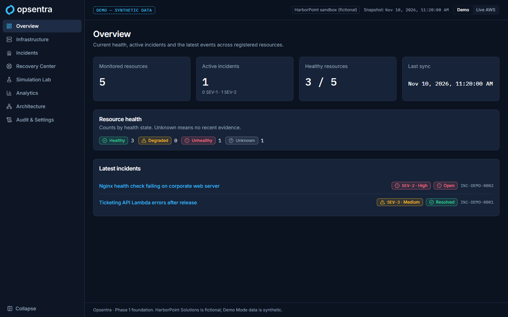
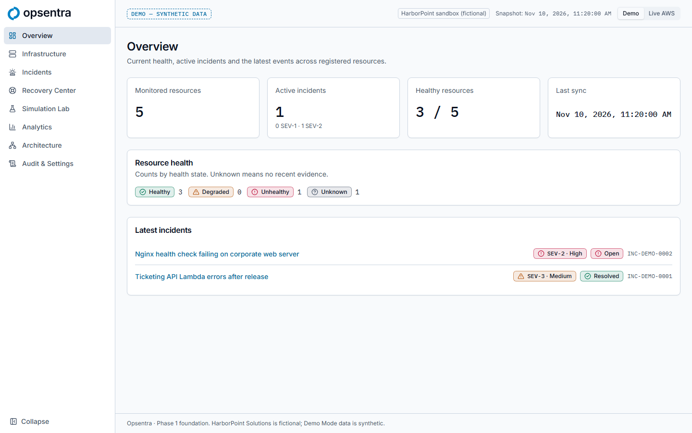
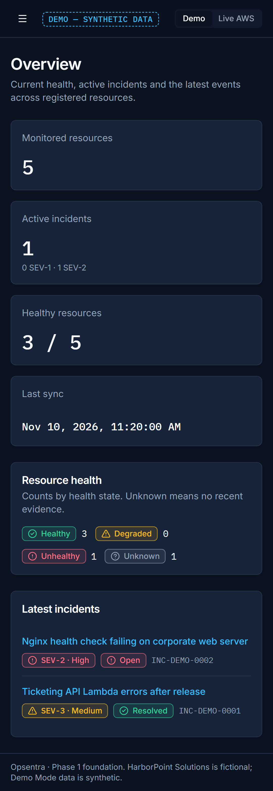
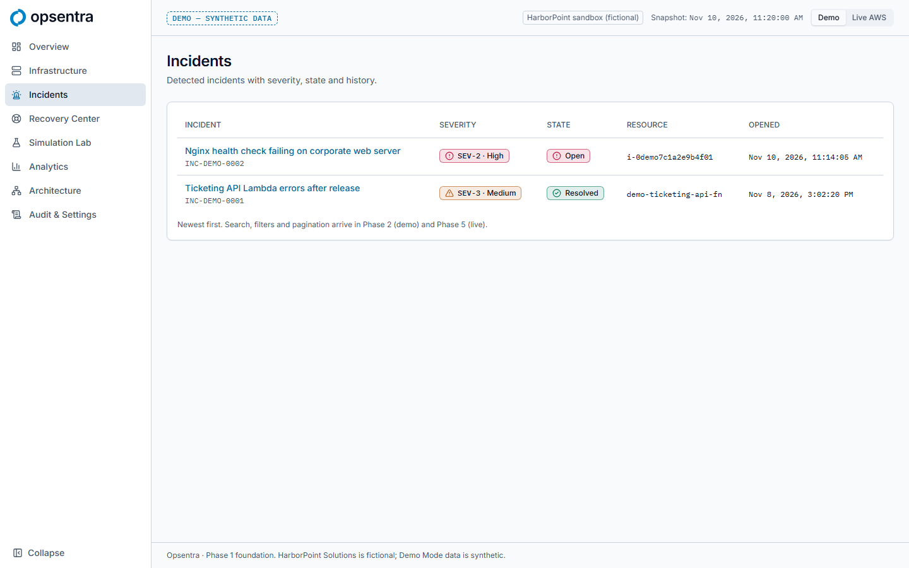
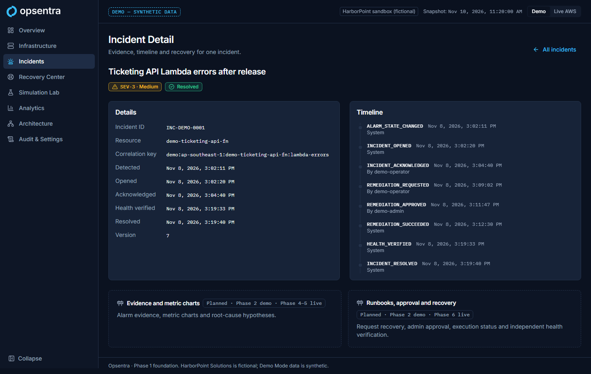
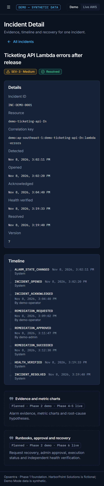
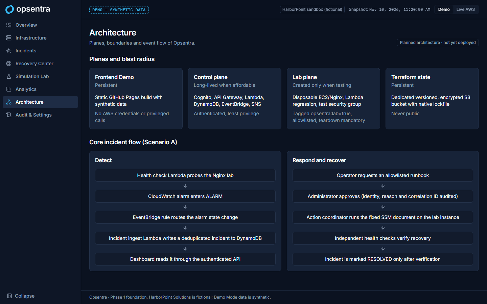
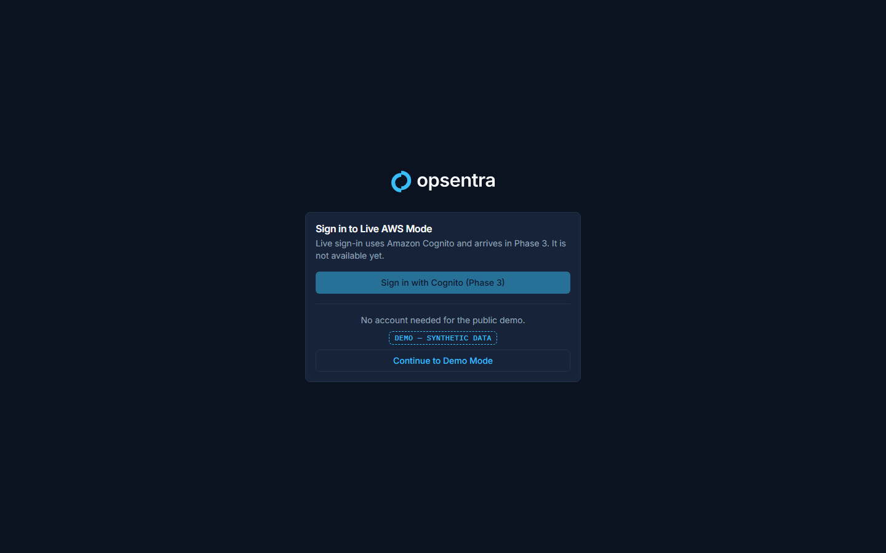

# Phase 1 checkpoint: Branding approval, foundation, UI/UX

- **Branch:** `feat/dashboard-foundation`
- **Status:** **Passed.** Approved by the owner on 2026-11-12, together with Phase 2.
- **Note (2026-11-12):** the owner chose to defer this review and continue to Phase 2, reviewing both phases together afterwards. See [Phase 2 checkpoint](phase-2-checkpoint.md). Phase 2 replaced the static snapshot described below with the interactive demo engine.

## Gate criteria (blueprint §7, Phase 1)

| Gate item | Evidence | Result |
|---|---|---|
| All routes functional | `src/app/routes.test.tsx`: every route renders its `h1` and the mode banner; E2E loads all 10 pages on desktop and mobile | Pass |
| Desktop/mobile, no clipping | E2E checks there is no horizontal page scroll at 1440×900 and Pixel 7 (412 px CSS width); screenshots below | Pass |
| WCAG-friendly focus and contrast reviewed | [Design review](phase-1-design-review.md): axe on every page (dark), three pages (light), focus and skip link E2E, computed contrast table | Pass, with the limits listed in the review |
| All placeholders clearly labelled | `PlannedPanel` shows `Planned · Phase N` on every unbuilt feature; Architecture page marked "not yet deployed" | Pass |
| Tests and build pass | See "Checks run" | Pass |
| Branding approved | ADR-010 (2026-11-10) | Pass |

## §7.1 checklist

- [x] Scope and artifacts complete: running frontend, brand kit in use, component library, typed DTOs + fixtures + mode guard, empty/error/auth/404 pages, architecture overview, design review checklist, CI
- [x] Screenshots recorded (`phase-1/screenshots/`)
- [x] Relevant automated tests passing
- [x] No unlabelled mock data in Live Mode: Live renders an error only (unit + E2E)
- [x] Auth/IAM and cost impacts reviewed: none. No AWS calls, no auth yet; the sign-in page has no credential form
- [x] Terraform plan/destroy and cleanup: not applicable (no infrastructure)
- [x] New assumptions, tradeoffs and ADRs documented: ADR-005 (agreed), ADR-010 (backfilled), ADR-011
- [x] README and master blueprint updated (blueprint v1.2.0)
- [x] Reviewed and committed (2026-11-12)
- [x] Ready for Phase 2

## Checks run (2026-11-12, Windows 11, Node 24.22.1)

| Check | Result |
|---|---|
| `npm run lint` | 0 problems |
| `npm run format:check` | Clean |
| `npm run typecheck` | 0 errors |
| `npm test` | 73 tests passed (4 files) |
| `npm run build` | Success. JS 523 kB / 161 kB gzip; Vite warns about the > 500 kB chunk (code splitting deferred to Phase 9) |
| `npm run e2e` | 27 passed, 1 skipped (mobile-only test on desktop) |
| `dist/` scan for keys / 12-digit IDs | None found |

CI (`.github/workflows/frontend-ci.yml`) runs the same steps on PRs. It has not run on GitHub yet because nothing has been pushed.

## Known limitations carried forward

- Overview, Infrastructure, Incidents and Incident Detail show a **static** synthetic snapshot. The scripted scenario engine, reset control and analytics arrive in Phase 2.
- Live AWS Mode is a fail-closed stub until Phases 3–4.
- Moderate `npm audit` advisories in the dev-only lint toolchain (ADR-005).
- No screen-reader walkthrough yet (Phase 9 accessibility audit).

## Screenshots

| | |
|---|---|
| Overview, dark, desktop |  |
| Overview, light, desktop |  |
| Overview, dark, mobile |  |
| Incidents, light, desktop |  |
| Incident Detail, dark, desktop |  |
| Incident Detail, dark, mobile |  |
| Architecture, dark, desktop |  |
| Sign-in, dark, desktop |  |
