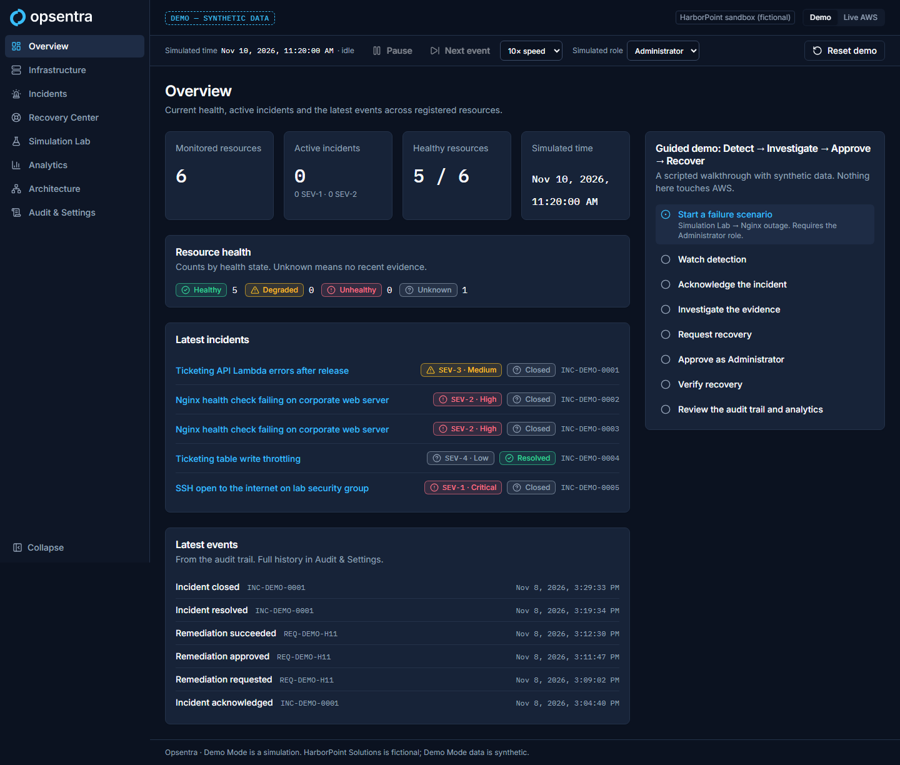
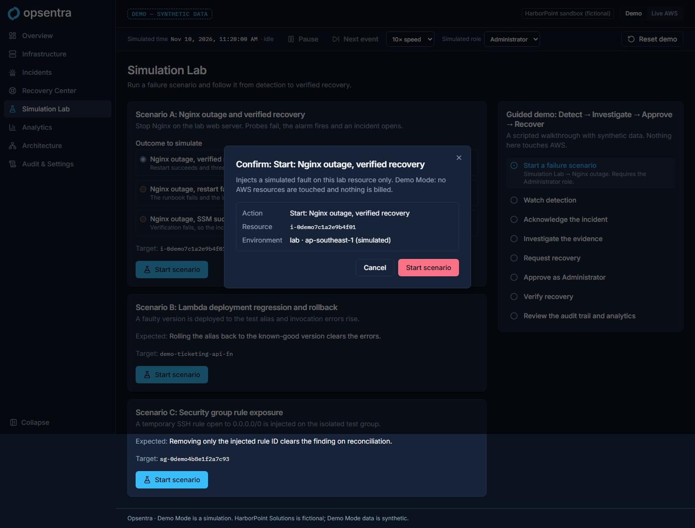
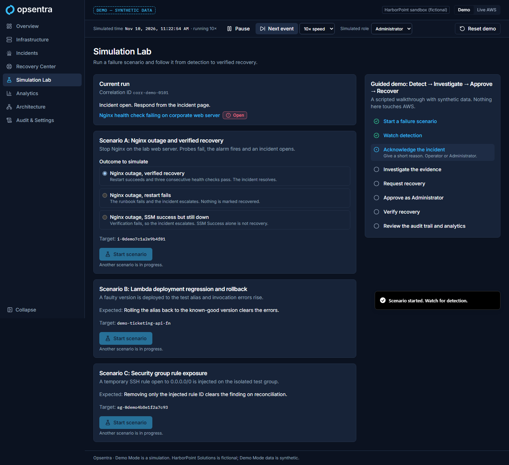
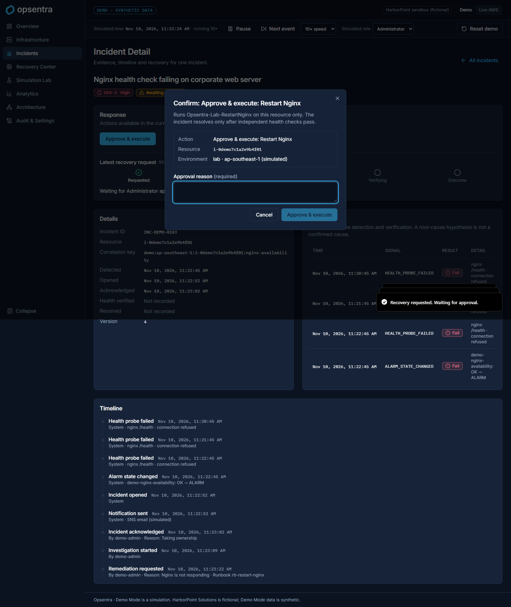
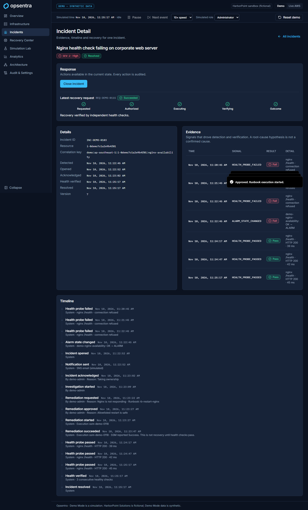
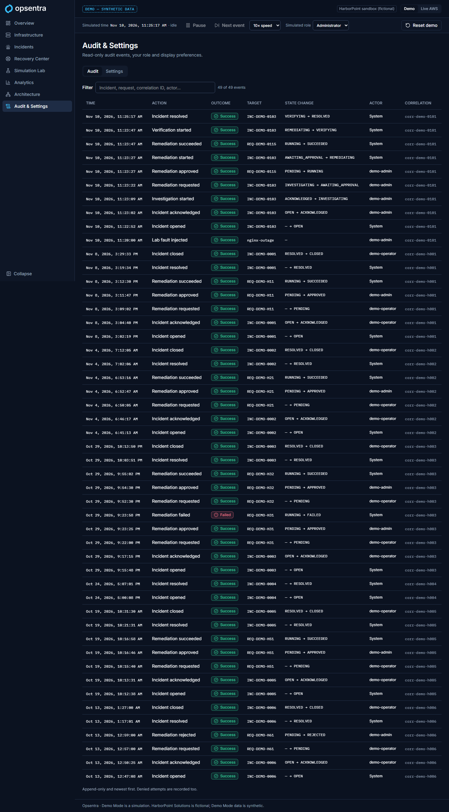
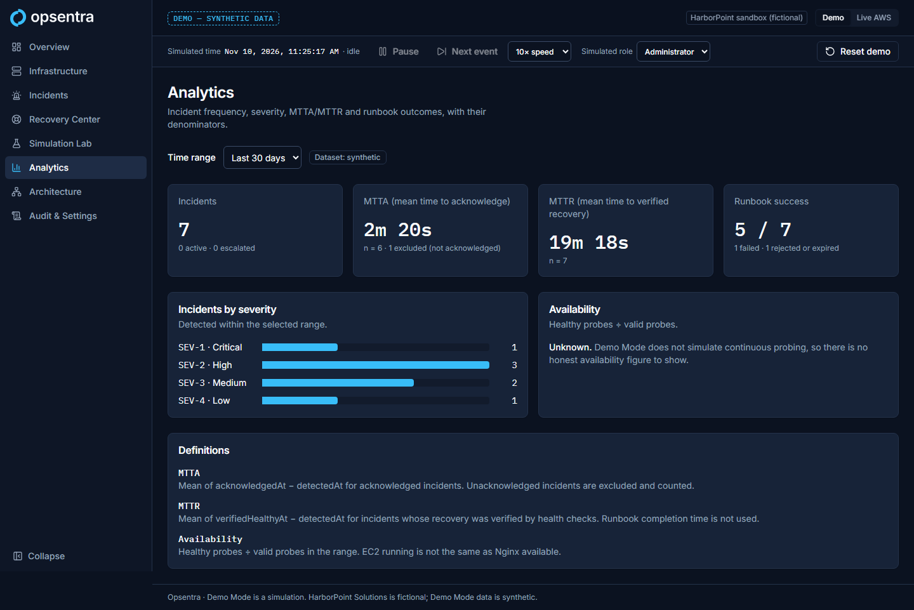
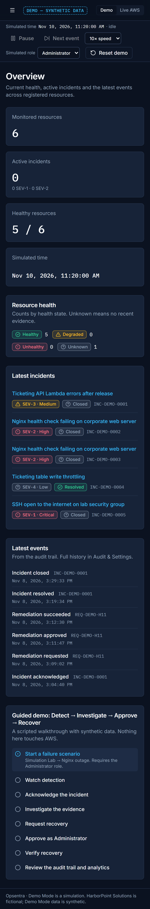
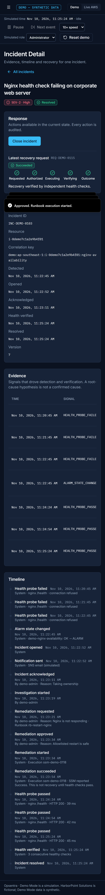

# Phase 2 checkpoint: Fully interactive Demo Mode

- **Branch:** `feat/dashboard-foundation` (Phases 1 and 2 together)
- **Status:** **Passed.** Approved by the owner on 2026-11-12, together with Phase 1.

## Gate (blueprint §7, Phase 2)

> A user can follow Detect → Investigate → Approve → Recover and review audit/events with **no terminal or AWS access**; no confusing simulated vs live telemetry.

| Gate item | Evidence | Result |
|---|---|---|
| Detect → Investigate → Approve → Recover in the browser | E2E `demo-flow.spec.ts` (desktop + mobile) drives the whole of Scenario A through the UI; unit `guided-flow.test.tsx` does the same in jsdom | Pass |
| Review audit and events | Audit tab lists every transition, approval, lab action and denied attempt with actor and correlation ID; incident timeline and evidence table | Pass |
| No terminal or AWS access | No network requests other than the app itself: unit test spies on `fetch`/XHR through a full scenario; every E2E test fails on any non-localhost request | Pass |
| No confusing simulated vs live telemetry | `DEMO — SYNTHETIC DATA` banner on every page; demo controls only in Demo; Live shows a fail-closed error on all 8 data pages (unit test); `meta.dataset: 'synthetic'` shown on Analytics | Pass |

## Deliverables (blueprint §7, Phase 2)

| Deliverable | Where |
|---|---|
| Public-safe demo | Whole app in Demo Mode; no credentials, no AWS calls |
| Dashboard | Overview: health, active incidents, latest events, guided walkthrough |
| Incident drill-down | Incident Detail: actions by state and role, recovery progress, evidence, timeline |
| Simulated Nginx recovery | Simulation Lab, Scenario A (+ restart-fails and SSM-success-but-down variants), plus Scenarios B and C |
| Demo badge | Persistent banner; "(simulated)" in confirmations; simulated role clearly labelled |
| Replay/reset control | Demo bar: pause/resume, speed 1–60×, Next event, simulated role, Reset demo (with confirmation) |

The blueprint's Phase 2 work list is also covered:
- **Error paths:** rejection, approval expiry, a failed runbook, SSM success with verification failing, 403/409/400 responses shown inside dialogs.
- **Analytics** derived from the simulated history.
- **Screen-reader progress:** the recovery stepper uses `aria-current` and text status, and state changes are announced through polite live regions.
- **Session persistence:** `sessionStorage`.
- **Guided path:** the walkthrough card.

## Blueprint §10.2 test cases covered in the demo engine

| # | Case | Test |
|---|---|---|
| 1, 2 | Viewer/Operator cannot approve or start labs | `engine.test.ts` "guards"; UI test "as Operator…" |
| 4 | Repeated alarm → no second incident or notification | `engine.test.ts` "repeated signals are deduplicated" |
| 5 | Duplicate approval never starts a second execution | `engine.test.ts` "a replayed approval…" |
| 6 | Version mismatch → 409 | `engine.test.ts` "a stale expectedVersion…" |
| 7 | SSM Success with service down stays unresolved | `engine.test.ts` + E2E "SSM success but service still down…" |
| 8 | Unknown/mismatched runbook blocked | `engine.test.ts` "refuses a runbook that is not allowlisted" |
| 10 | Demo never calls AWS | `data-hooks.test.tsx` + E2E request guard |
| 11 | Live failure never shows synthetic data | `routes.test.tsx` (8 pages) + E2E |
| 14 | MTTR excludes unresolved; sample sizes disclosed | `analytics.test.ts` |

These prove the *demo model* of the rules. The Live backend needs its own tests in Phases 5–6.

## §7.1 checklist

- [x] Scope and artifacts complete
- [x] Screenshots recorded (`phase-2/screenshots/`)
- [x] Relevant automated tests passing
- [x] No unlabelled mock data in Live Mode
- [x] Auth/IAM and cost impacts reviewed: none (no AWS). Roles in Demo are simulated and labelled as such
- [x] Terraform: not applicable
- [x] ADRs documented: ADR-012; blueprint v1.3.0
- [x] README and blueprint updated
- [x] Reviewed and committed (2026-11-12)
- [x] Ready for Phase 3. Phase 3 is the first phase that touches AWS; every `apply` needs explicit approval (CLAUDE.md)

## Checks run (2026-11-12, Windows 11, Node 24.22.1)

| Check | Result |
|---|---|
| `npm run lint` | 0 problems |
| `npm run format:check` | Clean |
| `npm run typecheck` | 0 errors |
| `npm test` | 105 tests passed (7 files) |
| `npm run build` | Success. JS 588 kB / 179 kB gzip (Vite's > 500 kB warning; code splitting deferred to Phase 9) |
| `npm run e2e` | 33 passed, 1 skipped (mobile-only test on desktop) |
| `dist/` scan for keys / 12-digit IDs | None found |

## Issues found and fixed during Phase 2

- On phones, Incident Detail overflowed sideways by 148 px: a wide evidence table stretched its grid column. Cards now have `min-w-0`, so tables scroll inside their own region.
- On phones, the guided walkthrough was at the bottom of Overview. It now comes first on small screens.

## Addition: Easy and Advanced views (ADR-013)

Added after the Phase 2 build at the owner's request. Easy is the default view. Checks: 28 Easy unit/flow/axe tests and an Easy E2E spec (desktop and phone, axe, no sideways scroll). The taste-skill gate passes with 0 FAIL and 0 WARN on Home, Incidents, Incident, Practice lab and Activity at 1440, 768 and 390. Screenshots: `phase-2/screenshots/easy-*`.

## Known limitations

- Availability shows "Unknown" in Demo: continuous probing is not simulated, so no percentage is invented.
- Percentiles for MTTA/MTTR are not shown (sample sizes are small); the denominators are.
- The audit table shows the newest 200 events; there is no paging yet (Live pagination arrives in Phase 5).
- The demo engine runs in the browser. It models the backend rules; it does not prove the Live implementation.

## Screenshots

| | |
|---|---|
| Overview with guide |  |
| Start confirmation |  |
| Detected |  |
| Approval dialog |  |
| Recovered and verified |  |
| Audit trail |  |
| Analytics |  |
| Mobile: overview, recovered |   |
