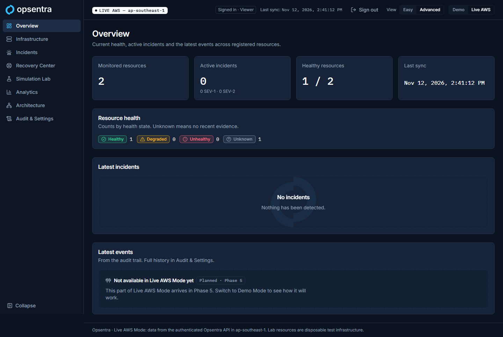
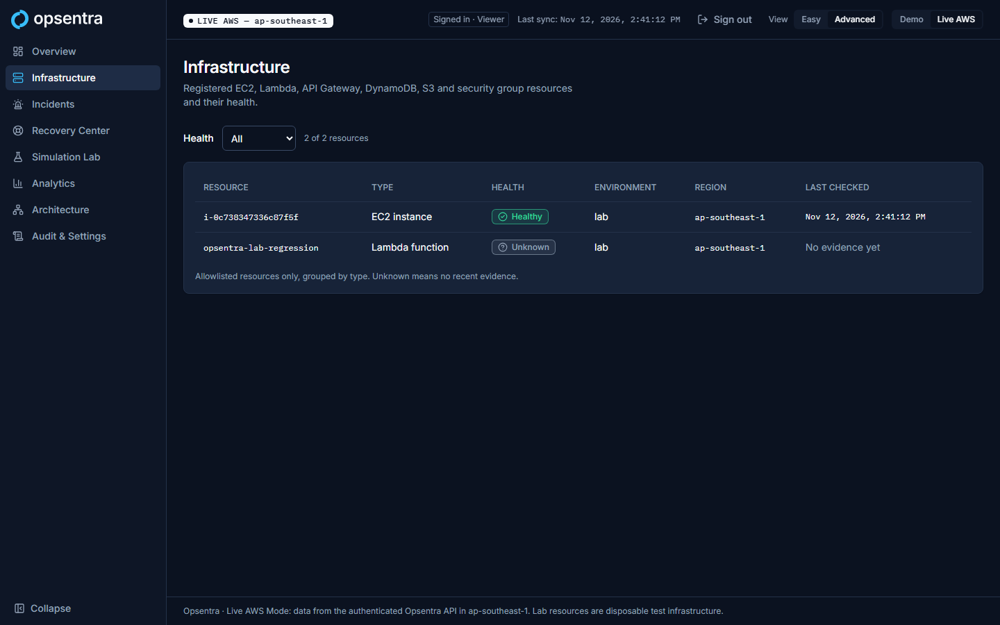
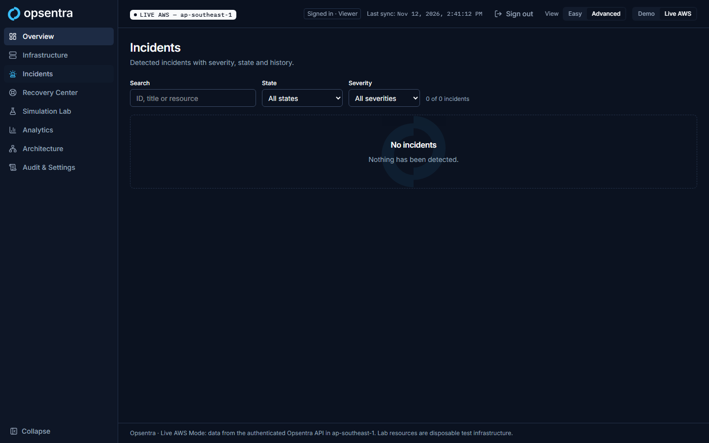

# Phase 4 checkpoint: Real AWS monitoring and inventory

- **Branch:** `feat/live-monitoring`
- **Status:** **All gate items pass (2026-11-12); awaiting the owner's gate review.** Lab destroyed with owner approval. Open: cost check once billing catches up (about 24 h).

## Gate (blueprint §7, Phase 4)

| Gate item | Evidence | Result |
|---|---|---|
| Stopping Nginx leads to a real health alarm in AWS | `Opsentra-Lab-StopNginx` sent 06:30:51 UTC (SSM `Success`); probes failed (connection refused); alarm **OK → ALARM at 06:34:24** (detection **3 min 33 s**); EventBridge logged the state change to `/aws/events/opsentra-lab-alarms`. Recovery: `Opsentra-Lab-RestartNginx` 06:35:12; probe HEALTHY 06:37:18; alarm **ALARM → OK at 06:37:24** (2 min 12 s), also logged | **Pass** |
| The UI shows actual resource and health data | Hosted UI sign-in (PKCE) as the viewer test user, then Live Infrastructure/Overview/Incidents (screenshots below, Live banner verified, 0 demo artefacts). During the outage the Live API returned EC2 `UNHEALTHY`, overview `UNHEALTHY: 1` | **Pass** |
| Metrics and alarm state are not hardcoded | `NginxAvailability` datapoints from the probe (0 during the outage, 1 after); registry health written by the probe; alarm history and EventBridge events from AWS | **Pass** |
| The lab can be destroyed | `terraform destroy` removed all 36 lab resources (2026-11-12). Read-only checks after: 0 running instances, 0 lab volumes, 0 EIPs, 0 lab VPCs and security groups, 0 lab alarms, schedules, rules, Lambdas, log groups, SSM documents and IAM roles, 0 registry items. The tag API still listed 8 entries; both instances were `terminated` and the volumes and groups no longer exist (index lag). Control plane unaffected (`/v1/health` 200) | **Pass** |

## Local checks (2026-11-12)

| Check | Result |
|---|---|
| Dashboard Vitest | 149 passed (16 new: PKCE, fail-closed Live source, freshness) |
| API pytest | 27 passed, 6 live skipped |
| Health probe pytest | 15 passed, including real HTTP probes; redirects never followed |
| `terraform test` | control-plane 9/9, disposable-labs 6/6, bootstrap 2/2 |
| checkov | 136 passed, 0 failed, 6 lab skips documented inline |
| ruff / eslint / tsc / prettier | Clean |

## Issues found during deployment and fixed

1. **API cold start:** the first `/v1/overview` call timed out at 5 s (boto3 import at 128 MB). Fix: the client is created at init, 256 MB, 10 s timeout. Now about 1.1 s cold.
2. **dnf OOM-killed on t4g.nano (512 MB):** Nginx was never installed, so the first alarm was a setup failure, not the gate test. Fix: a 1 GB swap file before `dnf`, plus a test.
3. **Stale registry on instance replacement:** the re-plan showed the allowlist would keep the old instance ID. Fix: `replace_triggered_by` on the registry items.
4. **Live shell honesty:** the top bar said "Not connected" and the footer described Demo Mode while live data was shown. Fix: Live status, last sync, sign-out and a Live footer; later-phase Live features show a neutral "Planned" panel.
5. **Tests picked up `.env.local`:** Vitest and the E2E build now pin the Live config to empty.

## Screenshots (Live mode, viewer)

| | |
|---|---|
| Overview |  |
| Infrastructure |  |
| Incidents |  |
