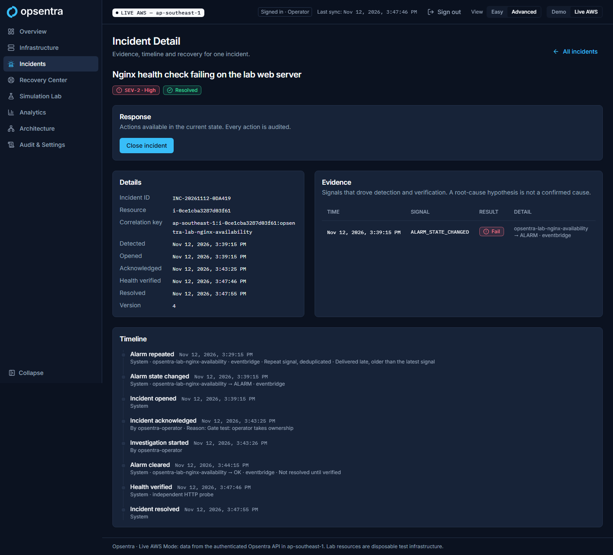
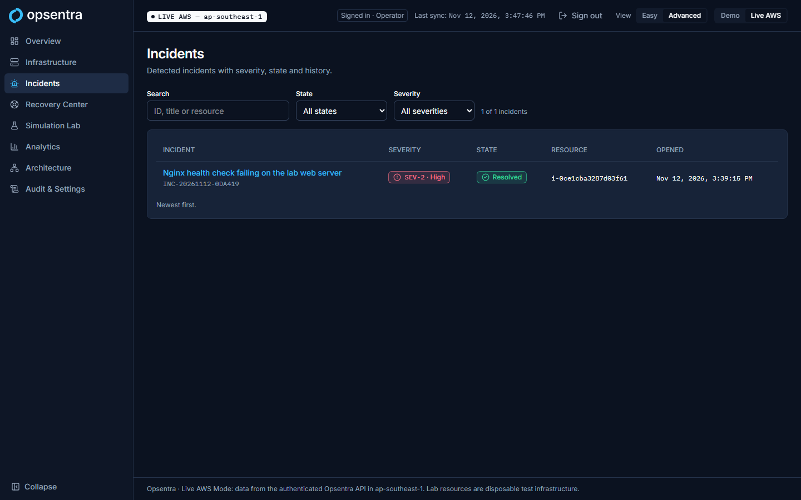
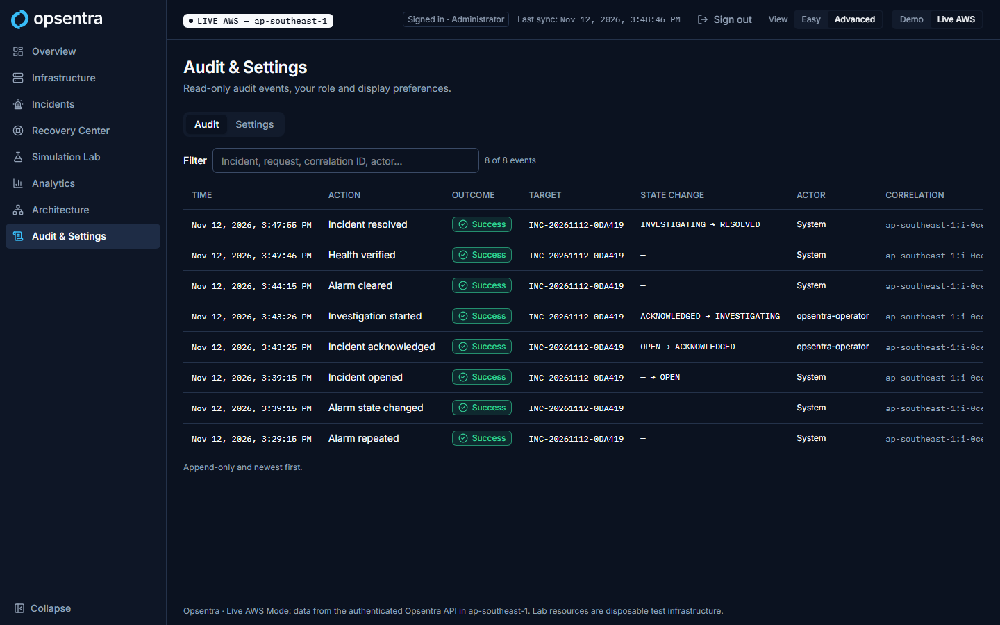

# Phase 5 checkpoint: Incident detection, management and audit

- **Branch:** `feat/incidents`
- **Status:** **Complete.** Gate passed live and approved by the owner on 2026-11-12. Control plane deployed; lab deployed for the test and destroyed (teardown verified).

## Gate (blueprint §7, Phase 5)

| Gate item | Local evidence | Live (2026-11-12, UTC) | Result |
|---|---|---|---|
| Duplicated events behave safely | `test_duplicate_delivery_is_a_no_op`, `test_concurrent_alarms_open_one_incident` | The real ALARM event re-sent to the ingest Lambda → `duplicate`, no write | **Pass** |
| Delayed and out-of-order events behave safely | `test_delayed_alarm_does_not_move_last_signal_back`, `test_out_of_order_ok_older_than_alarm_is_ignored`, `test_old_alarm_never_reopens_a_resolved_episode` | ALARM 10 min older → `repeated` (evidence only, `lastSignalAt` unchanged); OK older than the ALARM → `stale`, ignored | **Pass** |
| Malformed events behave safely | 8 parametrised rejections with no writes | No state, bad timestamp, foreign source, unregistered alarm → all `rejected`, no write | **Pass** |
| One active incident per active condition | Correlation transaction tests | Nginx stopped 07:36:04 → one incident `INC-20261112-0DA419` at 07:39:15; table count stayed 1 through all replays | **Pass** |
| Notification not repeated per duplicate | `test_repeated_alarm_adds_evidence_not_an_incident` | SNS `NumberOfMessagesPublished` = 1 for the whole test | **Pass** |
| Timeline tracks all user and system changes | Action and self-heal tests | 8 events: repeated (delayed), alarm changed, opened, acknowledged and investigating (operator, Live UI), alarm cleared, health verified, resolved | **Pass** |

### Live sequence

| Time (UTC) | Step |
|---|---|
| 07:34:15 | Lab applied (38 resources); probe HEALTHY, alarm OK at 07:35:39 |
| 07:36:04 | `Opsentra-Lab-StopNginx` (allowlisted SSM document) |
| 07:39:15 | Alarm → ALARM; EventBridge → ingest; incident OPEN, one SNS publish |
| 07:40 | Crafted events replayed to the ingest Lambda (results above) |
| 07:43:25–26 | Operator acknowledged (with reason) and started investigation in the Live UI; each state shown only after the API confirmed it |
| 07:43:35 | `Opsentra-Lab-RestartNginx` |
| 07:44:15 | Alarm → OK; incident stayed INVESTIGATING, `signalClearedAt` set ("not resolved until verified") |
| 07:47:46 | Independent HTTP probe HEALTHY (≥ 2 min after the clear) |
| 07:47:55 | Reconciler resolved the incident (`verifiedHealthyAt` 07:47:46); correlation cleared, `lastResolvedAt` kept |
| 07:50:30 | Lab destroyed (38); EC2, EBS, EIP, VPC, security groups, alarms, log groups, probe schedule and registry items all 0 |

Note: the alert email subscription was still pending confirmation during the test, so the evidence for "one alert" is the SNS publish count, not a delivered email.

### Found and fixed during the test

- Timeline showed an empty arrow (`alarm:  → `) for a repeated signal; the formatter now shows only known states and labels late deliveries (unit tests added).
- The Audit page said "Denied attempts are recorded too". That is true in Demo only; Live does not yet audit denied attempts, so the sentence now appears in Demo only.
- Phase 6 item: a delayed signal is placed in the timeline at its signal time, so it appears before the opening event. This is correct, but a "received at" marker would make it clearer.

## Screenshots (Live mode)

| View | Screenshot |
|---|---|
| Incident resolved, full timeline (operator) |  |
| Incident list |  |
| Audit (admin) |  |

## Costs

All new control-plane resources are within free tiers (SNS 1 publish, about 8,600 reconciler runs per month, DynamoDB on-demand pennies). The lab ran about 16 minutes (t4g.nano + public IPv4), under $0.01. Cost Explorer check pending billing data, together with the Phase 3/4 check.

## Local checks (2026-11-12)

| Check | Result |
|---|---|
| `services/incidents` pytest (moto) | 34 passed |
| `services/api` pytest | 39 passed, 6 live skipped |
| `services/health-check` pytest | 15 passed |
| Dashboard Vitest | 155 passed |
| Dashboard E2E | 37 passed |
| `terraform test` | control-plane 10/10, disposable-labs 6/6, bootstrap 2/2 |
| checkov | 175 passed, 0 failed |
